# What is design?

---
# What is design?

::: notes
Opening poll: "What is design?" (a live word-cloud poll in the original deck; collect answers aloud or in any poll tool).
:::

<figure class="dk-pic" style="left:5.56%;top:32.22%;width:20%;height:35.56%"></figure><figure class="dk-pic" style="left:28.57%;top:9.88%;width:9.56%;height:7.44%"></figure>

---

<figure class="dk-pic" style="left:9.27%;top:0%;width:90.73%;height:90.41%">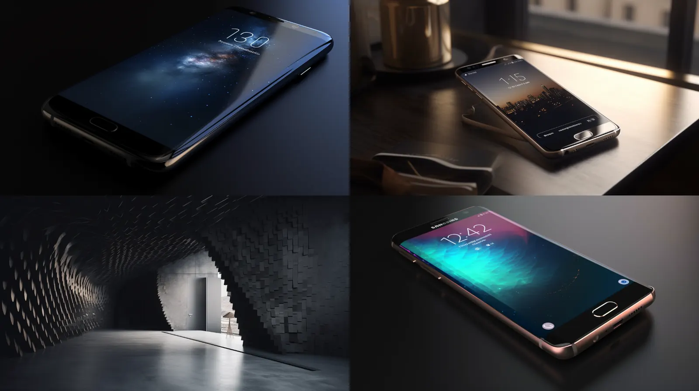</figure><figure class="dk-pic" style="left:0%;top:85.37%;width:30.1%;height:14.63%"></figure>
Image: Midjourney

::: notes
A quick look at AI-generated images for the prompt "design": what do people picture when they hear the word?
:::

---

# Formgiving

Design and user-centred thinking. Ondřej Brém

::: notes
Title slide of the MVT lecture.
:::

<figure class="dk-pic" style="left:0%;top:-9.86%;width:100%;height:118.49%">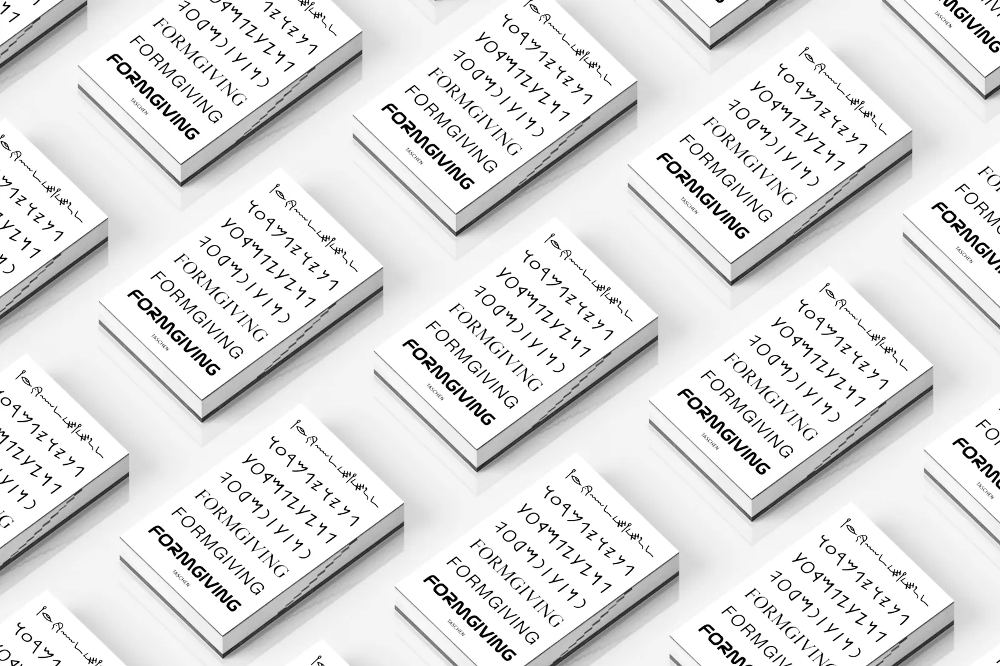</figure>

---

## Giving form to the future

> The Danish word for design, *formgivning*, literally means giving form to something that has not taken shape yet. In other words: giving form to the future.

::: notes
Paraphrase of a quote from a Danish architect. The name of the quoted person is left out of this repo version; add the attribution when presenting.
:::

---

<figure class="dk-pic" style="left:1.67%;top:2.96%;width:74.79%;height:94.07%">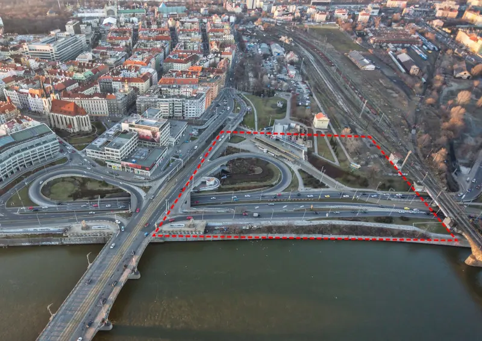</figure><figure class="dk-pic" style="left:64.75%;top:1.42%;width:34.33%;height:41.96%">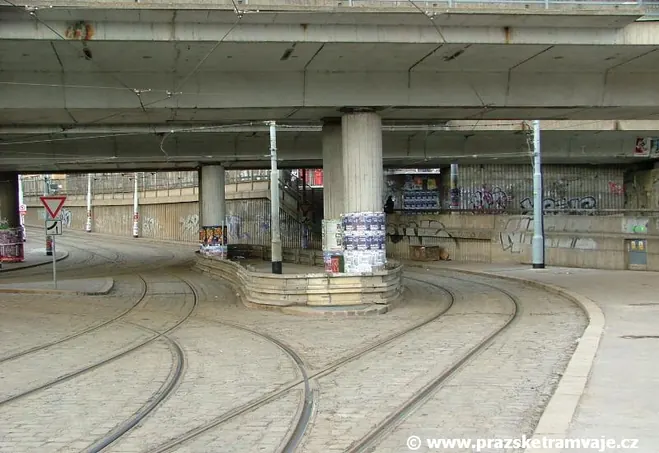</figure>
Photo right: prazsketramvaje.cz

::: notes
The site of the planned concert hall in Prague: where it will stand, and what the place looks like today.
:::

---

## Vltava Philharmonic by BIG

<figure class="dk-pic" style="left:0%;top:-6.62%;width:100%;height:106.62%">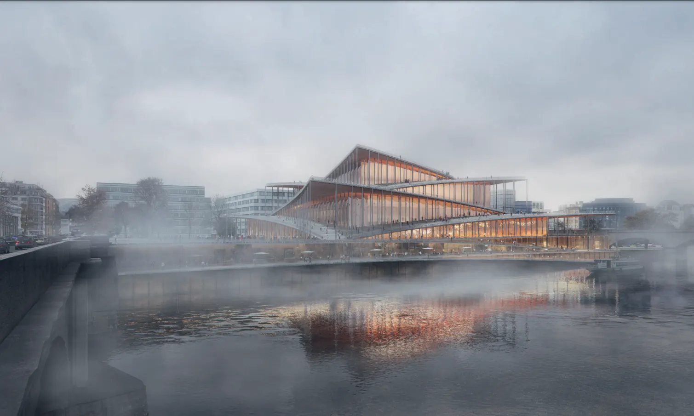</figure>
Rendering: BIG (Bjarke Ingels Group)

::: notes
A rendering of the hall, as an example of design that gives form to an idea before it exists.
:::

---

## Forms of interface design

- Desktop
- Smartphones
- Data visualization and data processing
- Cars
- Public space
- VR and AR
- Smart devices
- Aerospace applications

::: notes
The next eight slides show each form with pictures.
:::

---

## Desktop

<figure class="dk-pic" style="left:1.67%;top:2.96%;width:57.4%;height:57.41%">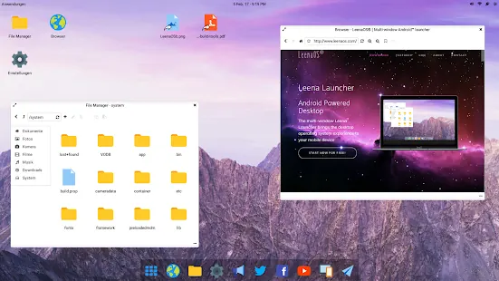</figure><figure class="dk-pic" style="left:60.73%;top:2.96%;width:37.6%;height:41.78%">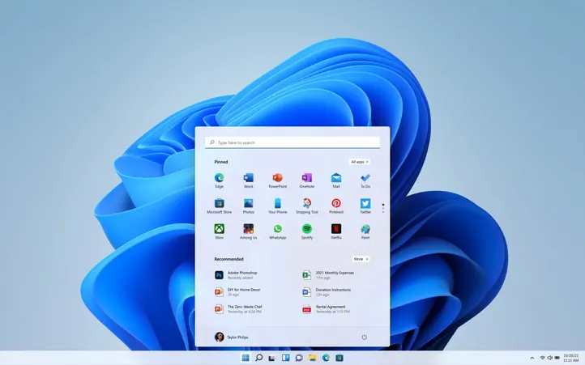</figure><figure class="dk-pic" style="left:60.73%;top:47.71%;width:37.6%;height:43.82%"></figure>

---

## Smartphones

<figure class="dk-pic" style="left:0.11%;top:0%;width:99.78%;height:100%">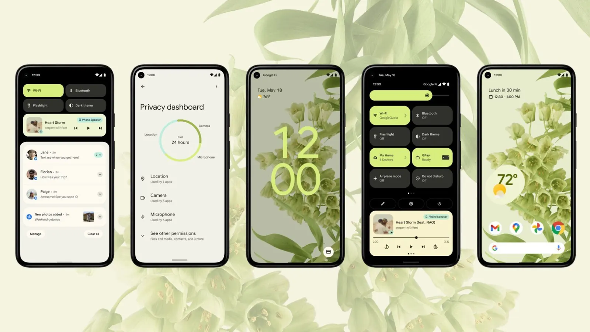</figure>

---

## Data visualization and data processing

<figure class="dk-pic" style="left:62.23%;top:58.23%;width:29.6%;height:39.47%">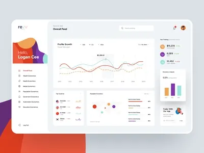</figure><figure class="dk-pic" style="left:11.62%;top:1.74%;width:39.21%;height:52.28%"></figure><figure class="dk-pic" style="left:52.44%;top:1.74%;width:45.89%;height:59.11%">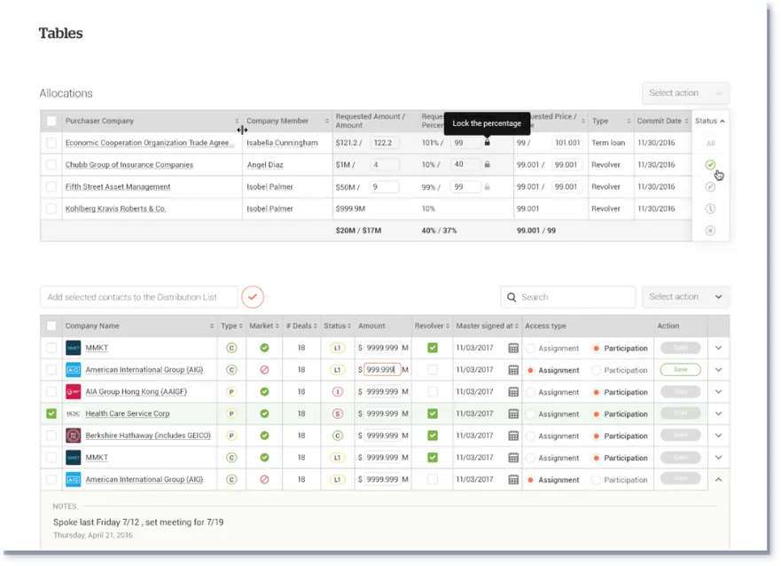</figure><figure class="dk-pic" style="left:28.78%;top:55.9%;width:31.35%;height:41.8%">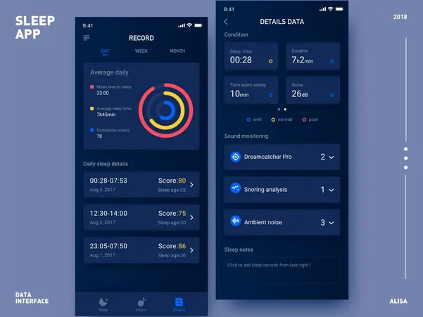</figure>

---

## Cars

<figure class="dk-pic" style="left:9.87%;top:44.68%;width:38.57%;height:38.57%">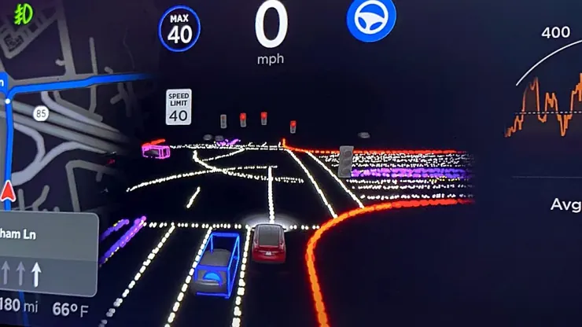</figure><figure class="dk-pic" style="left:49.53%;top:2.96%;width:44.37%;height:49.44%">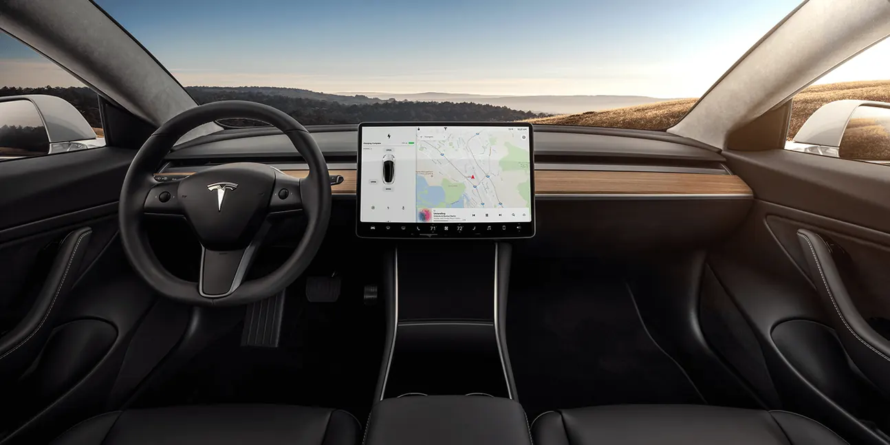</figure><figure class="dk-pic" style="left:49.53%;top:53.83%;width:42.11%;height:29.42%">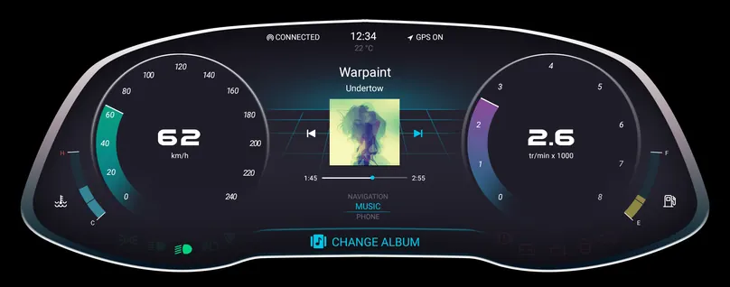</figure><figure class="dk-pic" style="left:7.38%;top:2.96%;width:41.07%;height:40.16%">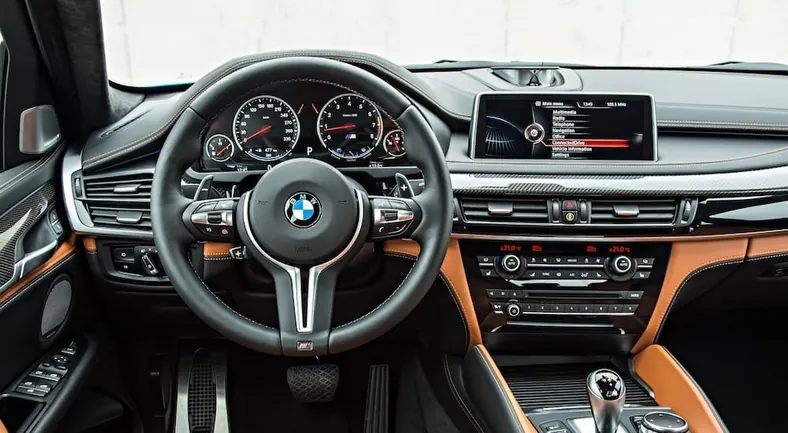</figure>

---

## Public space

<figure class="dk-pic" style="left:37.65%;top:44.06%;width:42.63%;height:53.11%">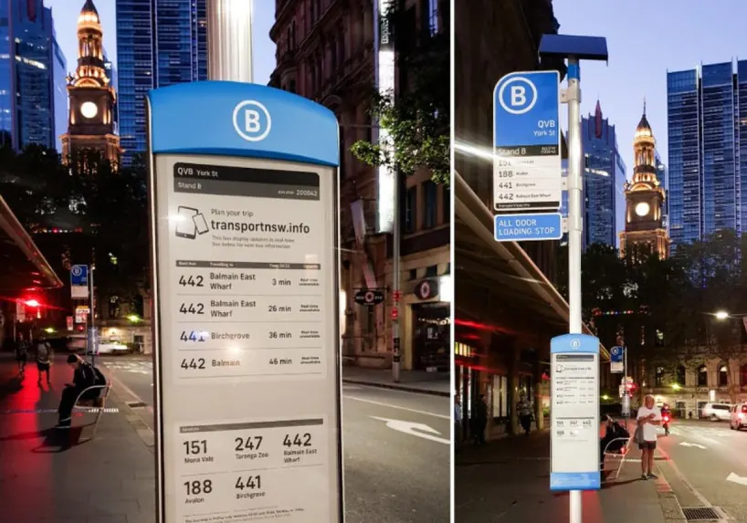</figure><figure class="dk-pic" style="left:1.67%;top:2.96%;width:35.16%;height:35.16%">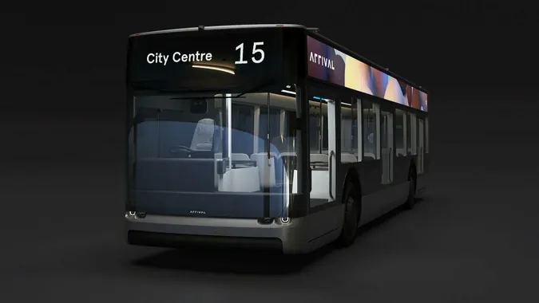</figure><figure class="dk-pic" style="left:4.59%;top:39.86%;width:32.24%;height:38.2%">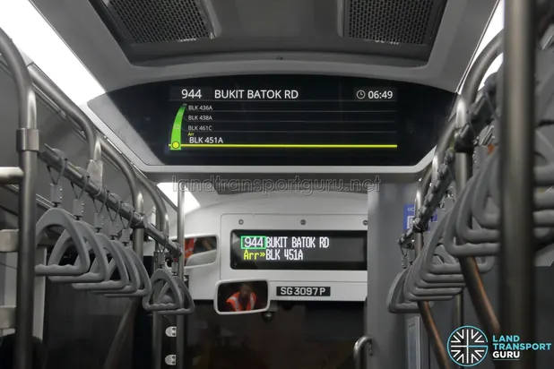</figure><figure class="dk-pic" style="left:37.65%;top:2.96%;width:29.31%;height:39.08%">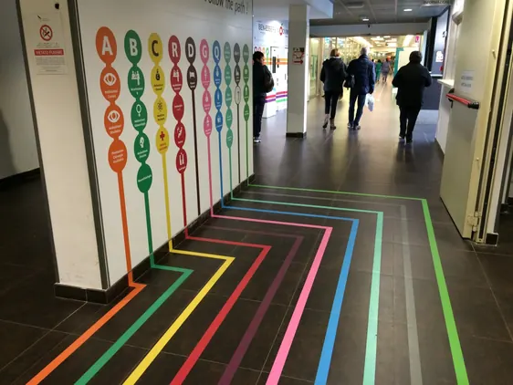</figure><figure class="dk-pic" style="left:67.79%;top:2.96%;width:21.98%;height:39.08%">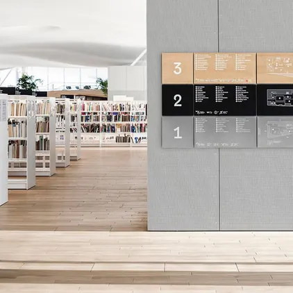</figure>

---

## VR & AR

<figure class="dk-pic" style="left:1.3%;top:3.08%;width:63.04%;height:60.18%">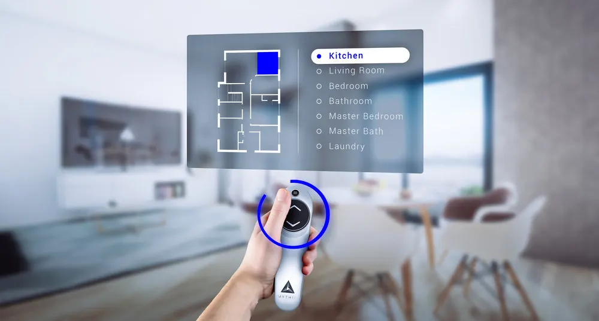</figure><figure class="dk-pic" style="left:51.17%;top:34.42%;width:47.04%;height:62.72%">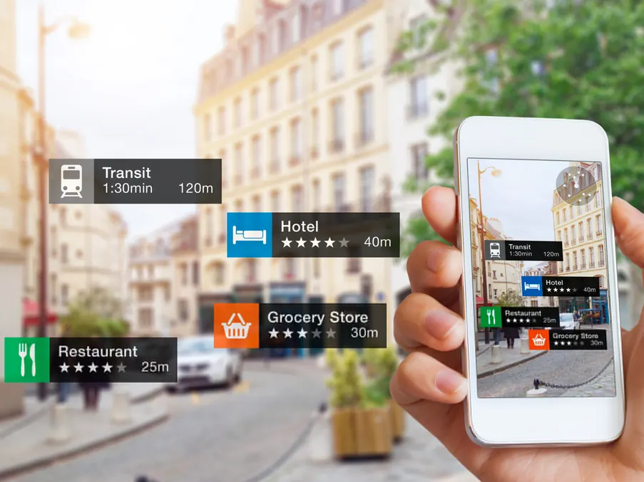</figure>

---

## Smart devices

<figure class="dk-pic" style="left:2.5%;top:3.29%;width:43.47%;height:39.97%"></figure><figure class="dk-pic" style="left:13.77%;top:44.11%;width:32.2%;height:38.14%">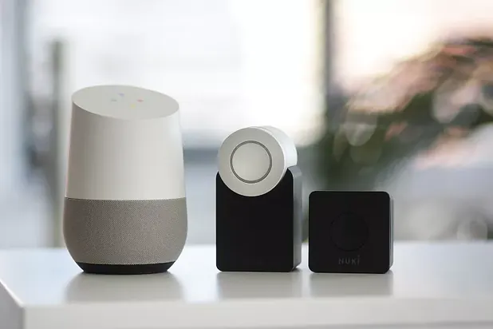</figure><figure class="dk-pic" style="left:47.1%;top:3.29%;width:36.39%;height:48.52%">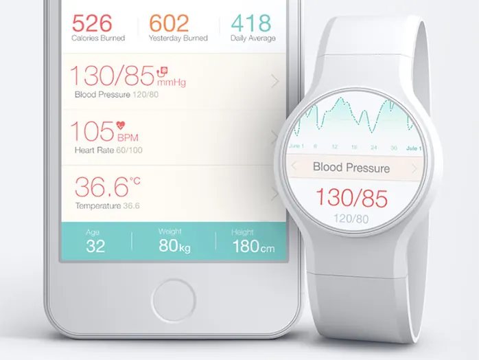</figure><figure class="dk-pic" style="left:47.1%;top:53.57%;width:42.52%;height:41.31%">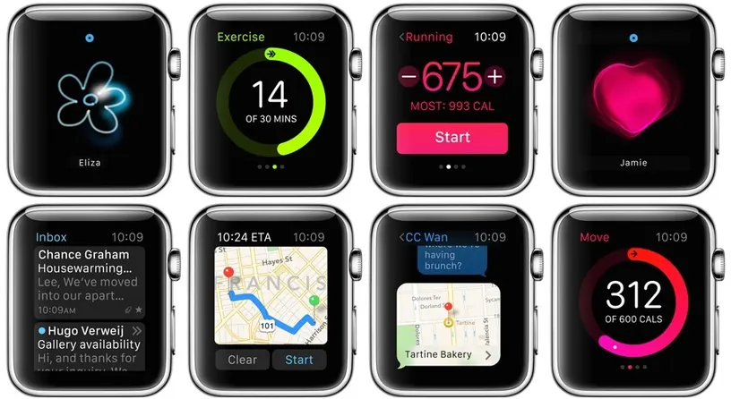</figure>

---

## Aerospace applications

<figure class="dk-pic" style="left:1.67%;top:2.96%;width:58.76%;height:58.76%">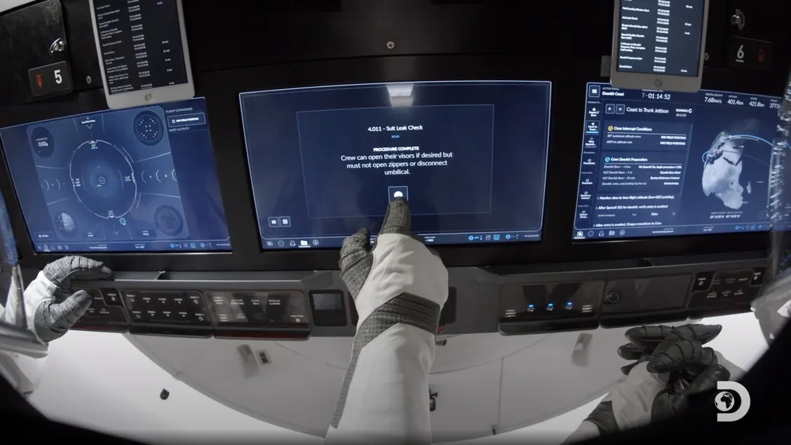</figure><figure class="dk-pic" style="left:62.1%;top:2.96%;width:36.24%;height:42.95%">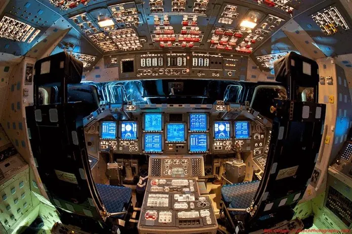</figure><figure class="dk-pic" style="left:50.7%;top:44.44%;width:46.35%;height:48.52%"></figure>

---

## Why do we design? What for?

::: notes
Poll: "Why do we create design? What for do we design?" Collect answers from the room before moving on.
:::

<figure class="dk-pic" style="left:28.57%;top:9.88%;width:9.56%;height:7.44%"><a href="https://www.sli.do/features-google-slides?payload=eyJwb2xsVXVpZCI6IjE5OTY3ZTJkLTcxZmYtNDc4MS1iZjUzLWZmOWE3NTg4NmM4NyIsInByZXNlbnRhdGlvbklkIjoiMVJSaWFaVXFjUGZCUXNlV0lHY2ZLX185djZuSklFUXZNU1VlSjU5ZXJtc1EiLCJzbGlkZUlkIjoiU0xJREVTX0FQSTQyOTU4MjMwXzAiLCJ0aW1lbGluZSI6W3sic2hvd1Jlc3VsdHMiOmZhbHNlLCJwb2xsUXVlc3Rpb25VdWlkIjoiMTBlNmY3MmYtZDFjZS00NDdhLWE4ODUtOWRjNzhhYTE5ZTZkIn0seyJzaG93UmVzdWx0cyI6dHJ1ZSwicG9sbFF1ZXN0aW9uVXVpZCI6IjEwZTZmNzJmLWQxY2UtNDQ3YS1hODg1LTlkYzc4YWExOWU2ZCJ9XSwidHlwZSI6IlNsaWRvUG9sbCJ9" target="_blank" rel="noopener" style="pointer-events:auto"></a></figure><figure class="dk-pic" style="left:5.56%;top:32.22%;width:20%;height:35.56%"></figure>

---

# User centered design

<figure class="dk-pic" style="left:0%;top:-0%;width:100.37%;height:100%"></figure>
Image: Midjourney

---

# Why?

---

## Take a guess

<figure class="dk-pic" style="left:28.76%;top:6.77%;width:66.73%;height:79.29%">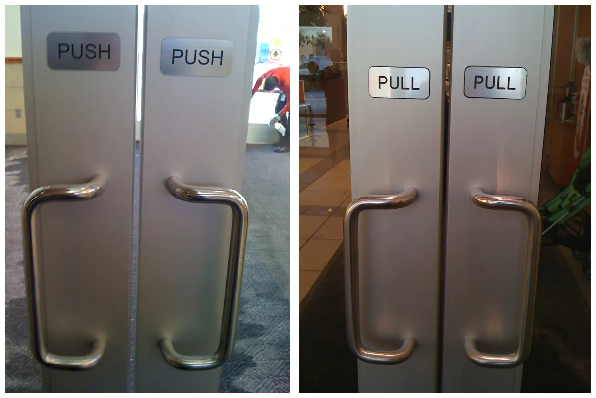</figure>

::: notes
A puzzling everyday object: two pairs of doors with the same handles. Ask the room which way each door opens.
:::

---

## Did you get it right?

<figure class="dk-pic" style="left:28.76%;top:6.77%;width:66.73%;height:79.29%"></figure>

::: notes
Reveal: the labels say Push and Pull, but the handles say pull on both.
:::

---

## Try it now...

<figure class="dk-pic" style="left:32.97%;top:1.75%;width:54.28%;height:96.49%">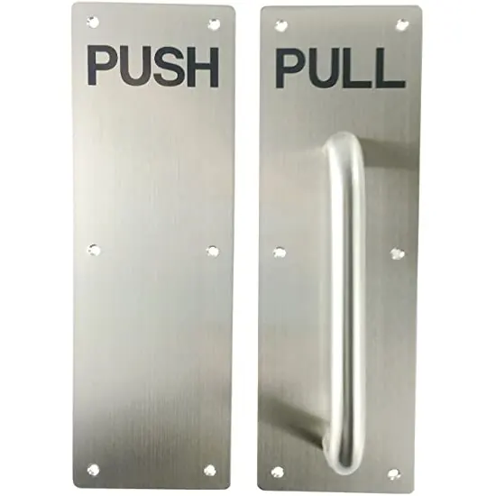</figure>

::: notes
The same task again with a better design: a flat plate to push, a handle to pull.
:::

---

## Easier?

<figure class="dk-pic" style="left:32.97%;top:1.75%;width:54.28%;height:96.49%"></figure>

---

## Make it obvious

::: notes
The point of the sequence: a good design makes the right action obvious without explanation.
:::

<figure class="dk-pic" style="left:20.75%;top:2.49%;width:76.49%;height:80.45%">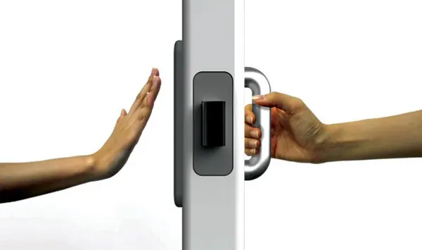</figure>

---

## Design fails

Give examples of design fails you have personally experienced.

::: notes
Poll: collect examples from the room.
:::

<figure class="dk-pic" style="left:5.56%;top:32.22%;width:20%;height:35.56%"></figure><figure class="dk-pic" style="left:28.57%;top:9.88%;width:9.56%;height:7.44%"></figure>

---

## Expectation vs reality

Problem / idea

Solution / product

<figure class="dk-pic dk-paper" style="left:5.91%;top:28.55%;width:88.18%;height:53.35%"></figure>

---

## Design process to the rescue

<figure class="dk-pic" style="left:0%;top:-18.49%;width:100%;height:118.49%">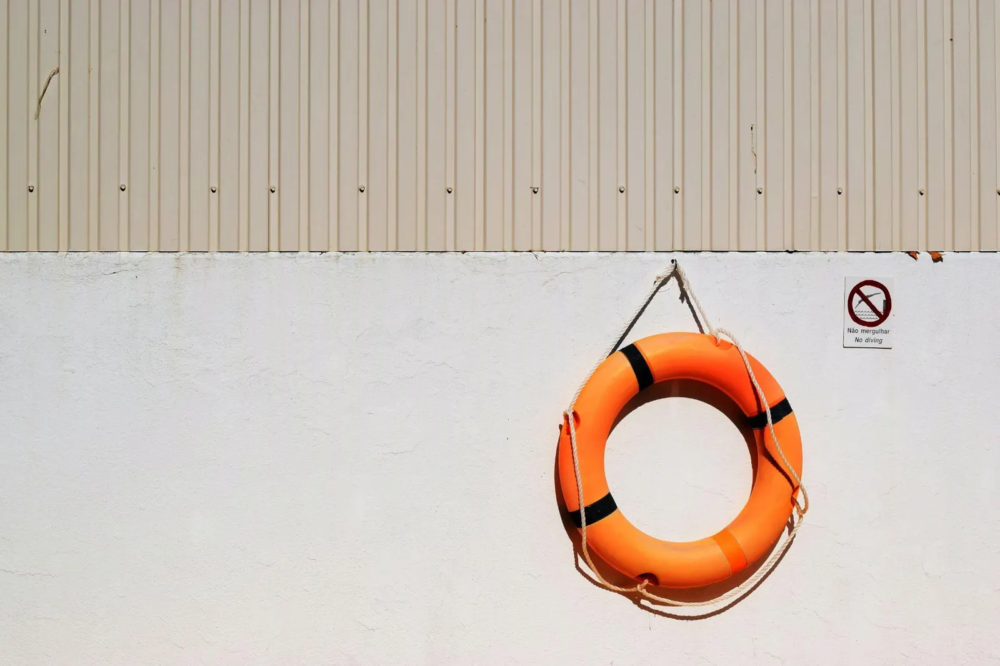</figure>

---

# How?

---

<figure class="dk-pic" style="left:0%;top:0%;width:100%;height:99.63%"></figure>
Image: Midjourney

---

<figure class="dk-pic" style="left:10%;top:18.04%;width:40%;height:75.66%">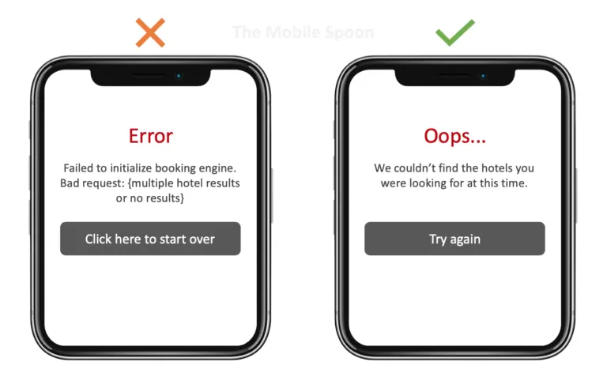</figure>
Image: The Mobile Spoon

::: notes
Which error message would you rather see?
:::

---

<figure class="dk-pic" style="left:10%;top:18.04%;width:80%;height:75.66%"></figure>
Image: The Mobile Spoon

::: notes
The friendly version says what happened and what to do next.
:::

---

# Empathy

- deeply understand your users

---

<figure class="dk-pic" style="left:1.67%;top:2.96%;width:75.96%;height:94.07%"><a href="https://www.nngroup.com/articles/case-study-iterative-design-prototyping/" target="_blank" rel="noopener" style="pointer-events:auto">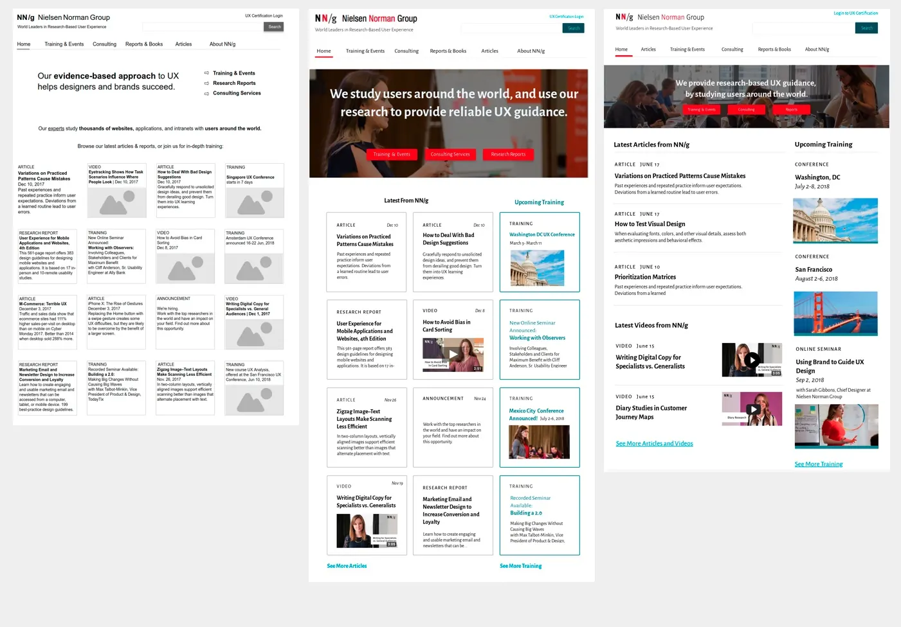</a></figure>
Screenshot: nngroup.com, case study on iterative design and prototyping

::: notes
A case study of iterative design and prototyping by Nielsen Norman Group: the same site over three rounds of testing. Click the picture to open the article.
:::

---

# Iteration

- keep on improving on feedback

---

<figure class="dk-pic" style="left:0.83%;top:1.48%;width:94.07%;height:94.07%">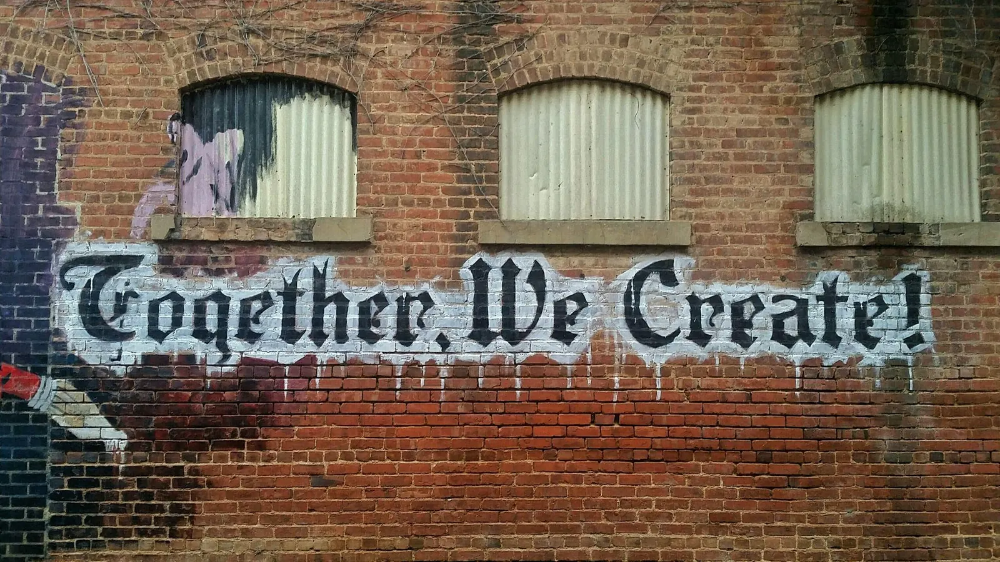</figure>
Photo by My Life Through A Lens on Unsplash

---

# Collaboration

- within and outside of the team

---

# Why products fail?

<figure class="dk-pic" style="left:86.23%;top:1.71%;width:13.07%;height:13.02%;transform:rotate(-0.000166667deg)"></figure>
Image: Midjourney

---

## Design phases

| Group | Phases |
| --- | --- |
| Research | Discover, Define |
| Design | Ideate, Prototype |
| Validation | Test, Refine |

- Design the right thing (problem)
- Design the thing right (solution)
- Between them: problem definition

::: notes
The original is a double-diamond style diagram: Discover, Define, Ideate, Prototype, Test, Refine, grouped as research, design and validation. The exact layout is not recoverable from the text, so this is a table. Replace with a drawn diagram if wanted.
:::

---

# HCD techniques

And how they fit the phases: Discover, Define, Ideate, Prototype, Test, Refine.

---

## Discover

<figure class="dk-pic" style="left:0%;top:0%;width:84.4%;height:100%"></figure>
Photo by N. on Unsplash

---

## Discover

- **User interviews**: qualitative data
- **Surveys**: quantitative data
- **Observation**: user behavior
- **Competitive analysis**: context

<figure class="dk-pic" style="left:0%;top:0%;width:32.48%;height:100%"></figure>
Photo by N. on Unsplash

---

## Define

<figure class="dk-pic" style="left:0%;top:0%;width:85.51%;height:100%"></figure>
Photo by Artturi Jalli on Unsplash

---

## Define

- **Problem statement**: clearly articulate the problem to be solved
- **Personas**: represent your target audience
- **User stories**: outline user needs and tasks
- **Empathy maps**: visualize user insights and emotions
- **Point of view statements**: summarize user needs and insights to guide design

<figure class="dk-pic" style="left:0%;top:0%;width:32.48%;height:100%"></figure>
Photo by Artturi Jalli on Unsplash

---

## Ideate

<figure class="dk-pic" style="left:0%;top:0%;width:83.24%;height:100%"></figure>
Photo by Patrick Tomasso on Unsplash

---

## Ideate

- **Mind mapping**: a visual way to follow idea flows
- **SCAMPER**: substitute, combine, adapt, modify, put to another use, eliminate, reverse
- **Role reversal**: temporarily take the view of someone else, such as a customer, a competitor or a historical figure, to get fresh insights
- **Sketching (4-step sketch)**: everyone sketches, which forces more thought
- **Brainwriting and lightning demos**: nobody is blocked from speaking during brainstorming

<figure class="dk-pic" style="left:0%;top:0%;width:32.46%;height:100%"></figure>
Photo by Patrick Tomasso on Unsplash

---

## Prototype

<figure class="dk-pic" style="left:0%;top:0%;width:84.4%;height:100%"></figure>
Photo by SpaceX

---

## Prototype

- **Office supplies**: paper, stickers, your hands, cardboard, foam
- **Prototyping software**: Figma, Sketch, Adobe XD, InVision
- **3D modeling software**: CAD, Blender, Maya, SketchUp
- **Real-life models**: 3D printing, LEGO, plywood, styrofoam
- **Other options**: generative AI, fake doors, marketing

<figure class="dk-pic" style="left:0%;top:0%;width:32.41%;height:100%"></figure>
Photo by SpaceX

---

## Test

<figure class="dk-pic" style="left:0%;top:0%;width:100%;height:100%"></figure>
Photo by SpaceX

---

## Test

- 5 second test
- UX test
- Fake door test
- Wizard of Oz test
- Beta release
- A/B test

- Screen recording
- Heat mapping
- Analytics
- Interviews with testers
- Surveys
- Performance evaluation

<figure class="dk-pic" style="left:0%;top:0%;width:32.33%;height:100%"></figure>
Photo by SpaceX

---

## Refine

<figure class="dk-pic" style="left:0%;top:0%;width:100%;height:100%"></figure>
Photo by SpaceX

---

# Must take forever, right?

<figure class="dk-pic" style="left:0%;top:-0%;width:100.37%;height:100%"></figure>
Image: Midjourney

---

## Starbase tour

::: notes
In the original a video (a tour of a rocket factory, part 1) is shown here to illustrate fast iteration. The video is not in this repo; show it from its public source if wanted.
:::

<figure class="dk-pic" style="left:4.16%;top:5.53%;width:91.68%;height:83.19%">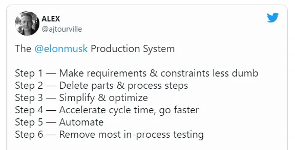</figure>
Post on X by @ajtourville

---

# The power of design sprints

<figure class="dk-pic" style="left:0%;top:0%;width:84.4%;height:100%"></figure>
Photo by Nicolas Hoizey on Unsplash

---

## Design sprint in 90 seconds

::: notes
In the original an explainer video of a venture firm's sprint process is shown. Not in this repo.
:::

<figure class="dk-pic" style="left:12.5%;top:0%;width:75%;height:100%"><a href="http://www.youtube.com/watch?v=K2vSQPh6MCE" target="_blank" rel="noopener" style="pointer-events:auto">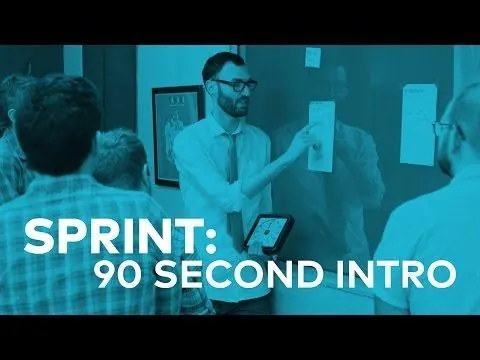</a></figure>
Video: GV (click to open)

---

# Design sprint

A time-bound, structured innovation process that brings cross-functional teams together to rapidly ideate, prototype and test solutions to complex problems, typically within a week.

| Day | Step |
| --- | --- |
| 1 | Understand |
| 2 | Define |
| 3 | Ideate |
| 4 | Prototype |
| 5 | Test |

---

## Design sprint

<figure class="dk-pic" style="left:27.91%;top:0%;width:59.11%;height:100%">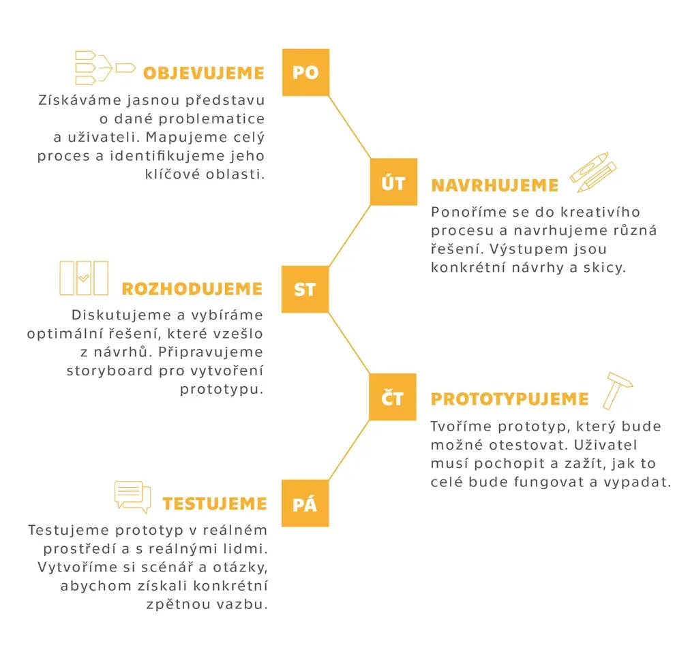</figure>

::: notes
The sprint week as a picture: Monday to Friday, one step a day.
:::

---

# Let's build something

::: notes
The original links to a social media post with the challenge. Link left out. Hands-on part: the group builds something quick.
:::

---

## Let's build something

<figure class="dk-pic" style="left:14.68%;top:2.19%;width:83.5%;height:82.23%">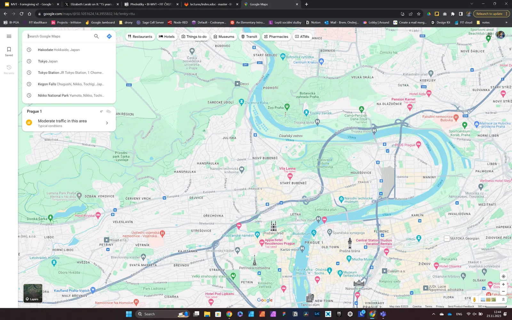</figure>
Screenshot: Google Maps

::: notes
Draw the challenge from a post by Eliz Laraki on X (the original slide linked it): a map app, as an example to rebuild.
:::

---

## Cars

<figure class="dk-pic" style="left:9.87%;top:44.68%;width:38.57%;height:38.57%"></figure><figure class="dk-pic" style="left:49.53%;top:2.96%;width:44.37%;height:49.44%"></figure><figure class="dk-pic" style="left:49.53%;top:53.83%;width:42.11%;height:29.42%"></figure><figure class="dk-pic" style="left:7.38%;top:2.96%;width:41.07%;height:40.16%"></figure>

---

## Public space

::: notes
The last two slides repeat the "forms of interface design" topics (cars, public space) as possible themes for the build exercise. Several trailing slides in the source are empty.
:::

<figure class="dk-pic" style="left:37.65%;top:44.06%;width:42.63%;height:53.11%"></figure><figure class="dk-pic" style="left:1.67%;top:2.96%;width:35.16%;height:35.16%"></figure><figure class="dk-pic" style="left:4.59%;top:39.86%;width:32.24%;height:38.2%"></figure><figure class="dk-pic" style="left:37.65%;top:2.96%;width:29.31%;height:39.08%"></figure><figure class="dk-pic" style="left:67.79%;top:2.96%;width:21.98%;height:39.08%"></figure>

---

<figure class="dk-pic" style="left:1.67%;top:2.96%;width:32.18%;height:76.32%">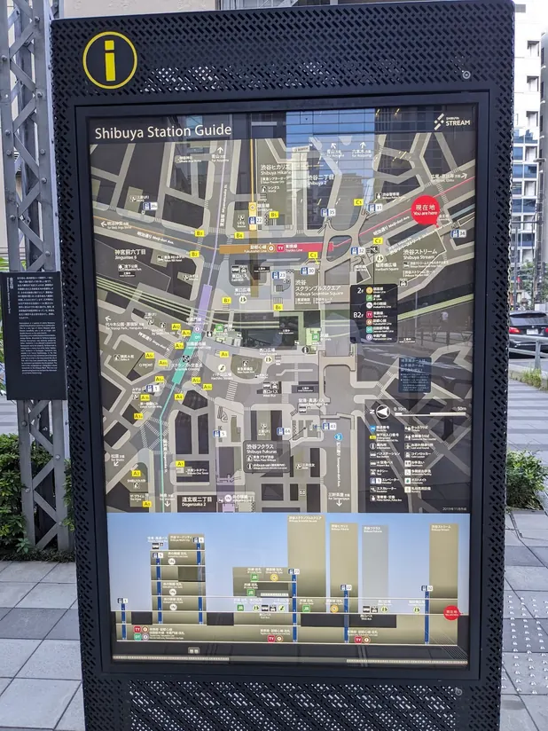</figure>

::: notes
A station map board in Tokyo: public space as an interface.
:::

---

<figure class="dk-pic" style="left:0.31%;top:0%;width:25.3%;height:100%">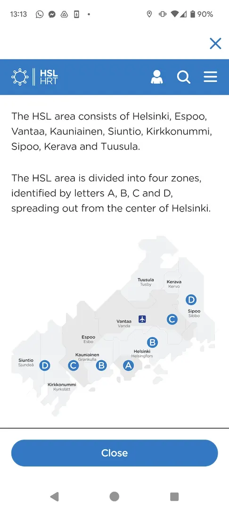</figure><figure class="dk-pic" style="left:76.2%;top:0%;width:23.8%;height:94.07%">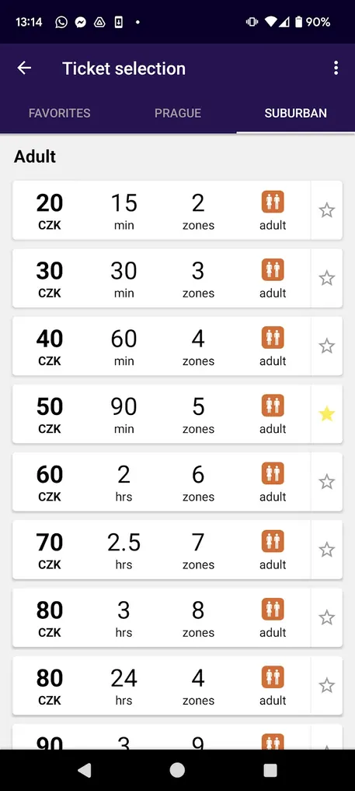</figure><figure class="dk-pic" style="left:50.92%;top:0%;width:25.3%;height:100%">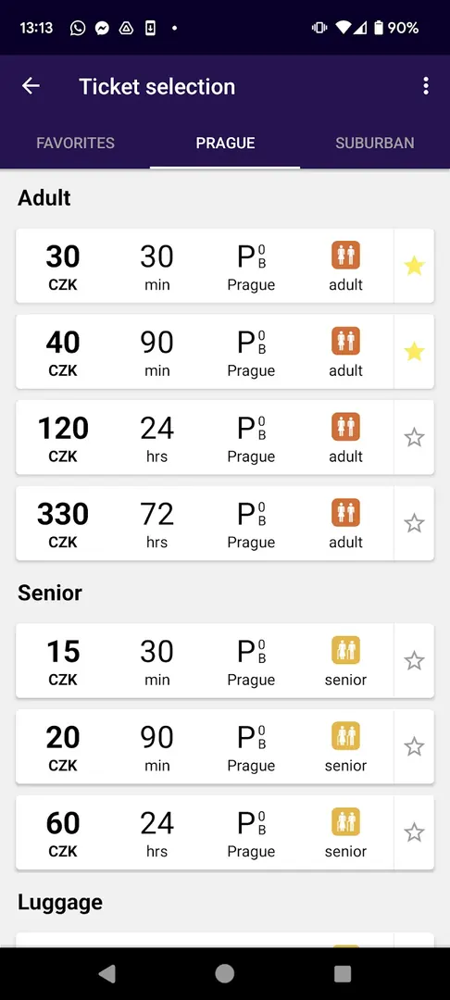</figure><figure class="dk-pic" style="left:18.29%;top:0%;width:25.3%;height:100%">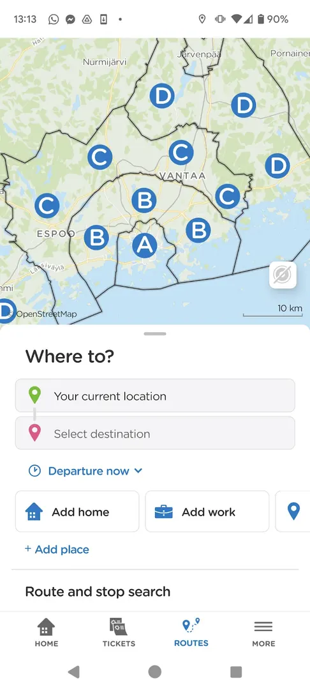</figure><figure class="dk-pic" style="left:38.68%;top:0%;width:25.3%;height:100%">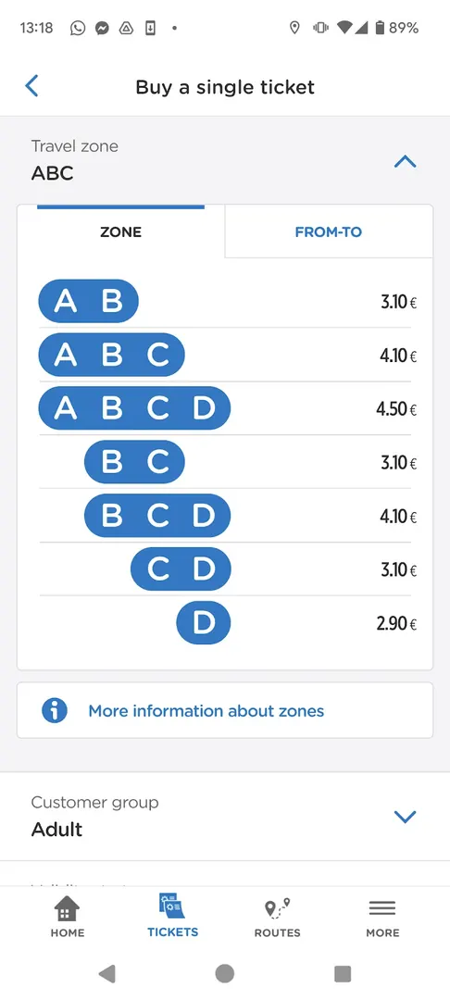</figure>
Screenshots: HSL app

::: notes
The fare zones of Helsinki in the HSL app: how an app explains a complex system.
:::
