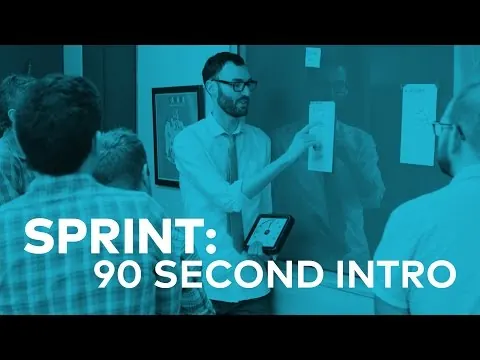
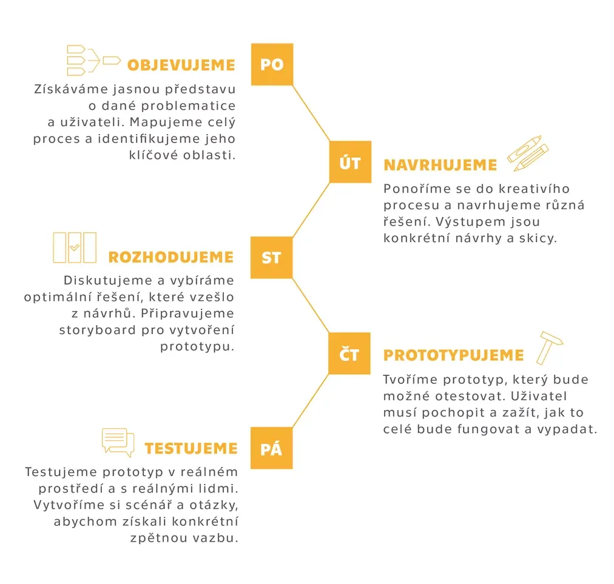
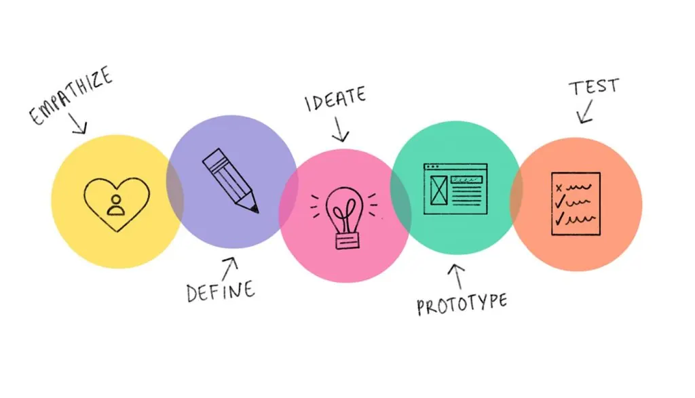
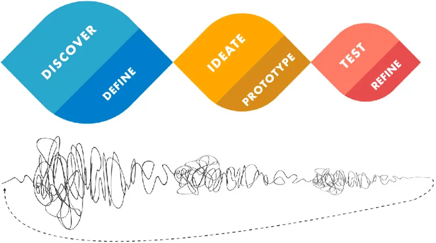

# NI-PSD
## Intro to HCD

---

# Technical issues

MS Teams  
Date and time collision?

---

# Your experience with UX and HCD = ?

::: notes
Short discussion with the students. The original has no more text on this slide.
:::

---

<figure class="dk-pic" style="left:12.5%;top:0%;width:75%;height:100%"></figure>
Video: GV, Sprint 90 second intro (click to open)

::: notes
Play the 90-second video by GV: click the picture to open it on YouTube.
:::

---

# Design sprint

<figure class="dk-pic" style="left:34.86%;top:2.66%;width:55.96%;height:94.67%"></figure>

::: notes
The sprint week as the course runs it: discover, sketch, decide, prototype, test.
:::

---

# Design thinking

<figure class="dk-pic" style="left:27.38%;top:12.57%;width:73.46%;height:74.86%"></figure>

::: notes
The design thinking process. The next five slides take its phases one by one.
:::

---

# Empathize

---

# Define

---

# Ideate

---

# Prototype

---

# Validate

---

# Design thinking

<figure class="dk-pic" style="left:26.54%;top:12.57%;width:73.46%;height:74.86%"></figure><figure class="dk-pic" style="left:27.13%;top:14.17%;width:72.29%;height:71.66%"></figure>
Squiggle after The Design Squiggle by Damien Newman

::: notes
Closing overview: the five phases again, then the design squiggle, which shows how messy the start of the process is.
:::

---

# A production system in six steps

1. Make requirements and constraints less dumb
2. Delete parts and process steps
3. Simplify and optimize
4. Accelerate cycle time, go faster
5. Automate
6. Remove most in-process testing

::: notes
In the original this list is a screenshot of a social-media post by a well-known entrepreneur, used as a contrast to design thinking. The author and the exact wording are left out here; the steps are lightly reworded. Restore the source if it is public and quotable.
:::

---

<figure class="dk-pic" style="left:-1.61%;top:-0%;width:103.21%;height:100%"></figure>
Meme made with makeameme.org

---

# Teams

- 4 members
- Different backgrounds of members
- Establish a member responsible for team communication
- ... what else?

---

# Teams: role

Question of the team-forming survey (in Czech, as in the original):

**Jaká role je pro vás prioritní v rámci projektu?**

- UX Designer
- Projekťák
- Programátor
- Výzkumník
- Business developer
- Obchodník

---

# Teams: study programme

Question of the team-forming survey (in Czech, as in the original):

**Jaké zaměření máte za sebou/nebo ho studujete?**

- Informační bezpečnost
- Manažerská informatika
- Počítačová grafika
- Počítačové inženýrství
- Sítě a Internet

- Systémy a virtualizace
- SW inženýrství
- Teoretická informatika
- Umělá inteligence
- Webové inženýrství

---

# Homework

- If not working on Solar roofs, prepare a pitch of your project idea
- Look around and find useful information and resources for your project
- Think about who you need to talk to to make the project successful
