# UX/UI

::: en
What is it all about?
:::
::: cs
Oč tu vlastně běží?
:::

::: notes en
Opening. Slide 2 starts with a short warm-up on experiences, before any definitions.
:::
::: notes cs
Úvod. Další slide začíná krátkou rozcvičkou na zážitcích, ještě před definicemi.
:::

---

::: en
# Experiences: the artifact jury
:::
::: cs
# Zážitky
:::

::: notes en
The next ten slides are the artifacts, one per slide as in the original deck. Click through them; each pair picks one artifact for the next task.
:::

::: notes cs
Dalších deset slidů jsou artefakty, jeden na slide jako v původní prezentaci. Proklikejte je; každá dvojice si vybere jeden artefakt pro další úkol.
:::

---

::: en

<figure class="dk-pic" style="left:36.58%;top:2.96%;width:26.85%;height:94.07%">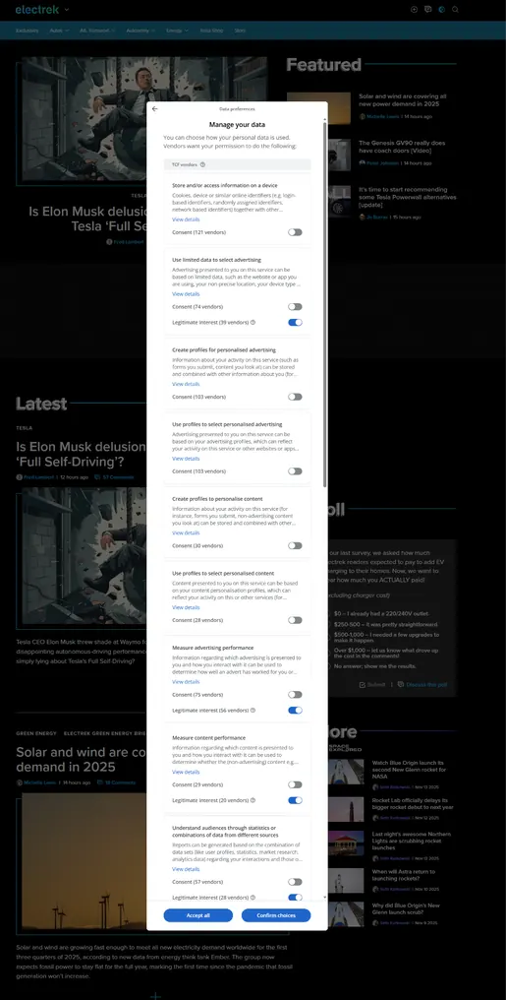</figure>
Screenshot: electrek.co

:::

::: cs

<figure class="dk-pic" style="left:36.58%;top:2.96%;width:26.85%;height:94.07%"></figure>
Screenshot: electrek.co

:::

::: notes en
Artifact 1 of 10.
:::

::: notes cs
Artefakt 1 z 10.
:::

---

::: en

<figure class="dk-pic" style="left:33.67%;top:2.96%;width:32.66%;height:94.07%">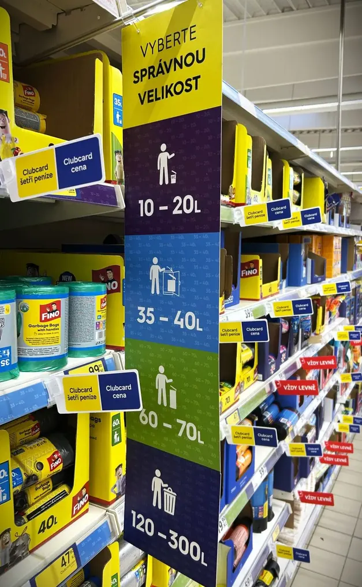</figure>

:::

::: cs

<figure class="dk-pic" style="left:33.67%;top:2.96%;width:32.66%;height:94.07%"></figure>

:::

::: notes en
Artifact 2 of 10.
:::

::: notes cs
Artefakt 2 z 10.
:::

---

::: en

<figure class="dk-pic" style="left:8.54%;top:9.72%;width:82.92%;height:80.56%">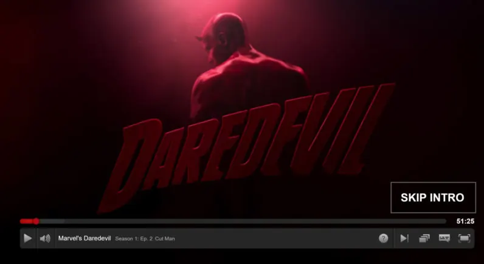</figure>
Screenshot: Netflix

:::

::: cs

<figure class="dk-pic" style="left:8.54%;top:9.72%;width:82.92%;height:80.56%"></figure>
Screenshot: Netflix

:::

::: notes en
Artifact 3 of 10.
:::

::: notes cs
Artefakt 3 z 10.
:::

---

::: en

<figure class="dk-pic" style="left:1.67%;top:2.96%;width:59.92%;height:54.04%">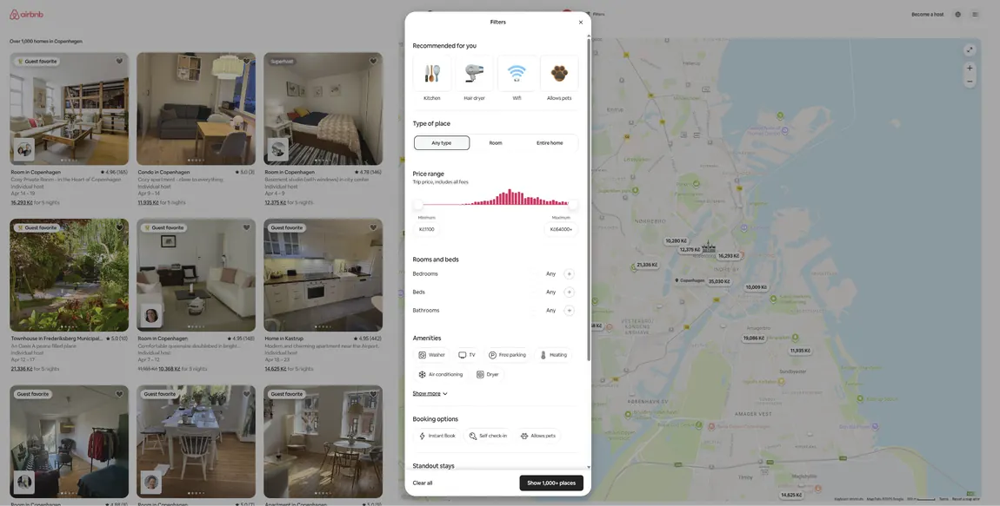</figure><figure class="dk-pic" style="left:55.43%;top:36.9%;width:43.51%;height:54.76%">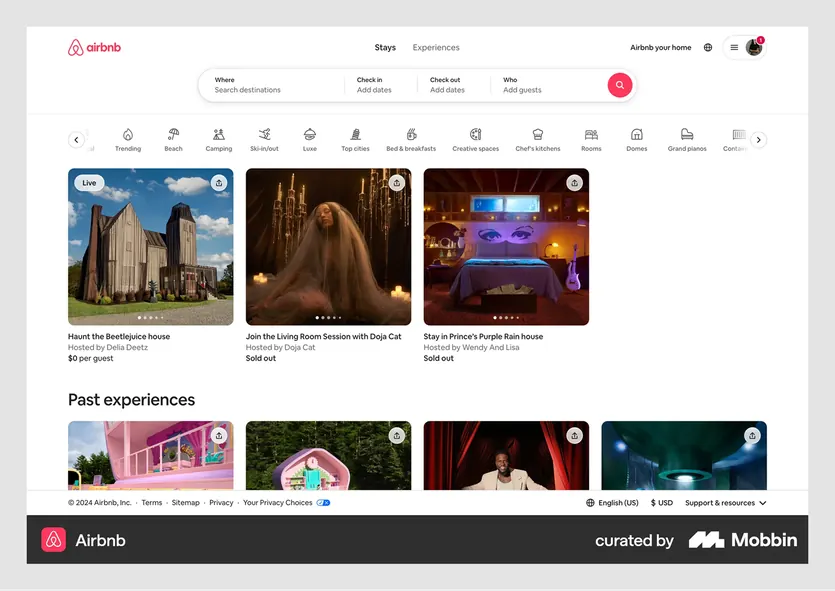</figure>
Screenshots: Airbnb; right: via Mobbin

:::

::: cs

<figure class="dk-pic" style="left:1.67%;top:2.96%;width:59.92%;height:54.04%"></figure><figure class="dk-pic" style="left:55.43%;top:36.9%;width:43.51%;height:54.76%"></figure>
Screenshots: Airbnb; right: via Mobbin

:::

::: notes en
Artifact 4 of 10.
:::

::: notes cs
Artefakt 4 z 10.
:::

---

::: en

<figure class="dk-pic" style="left:0%;top:13.72%;width:100%;height:72.57%">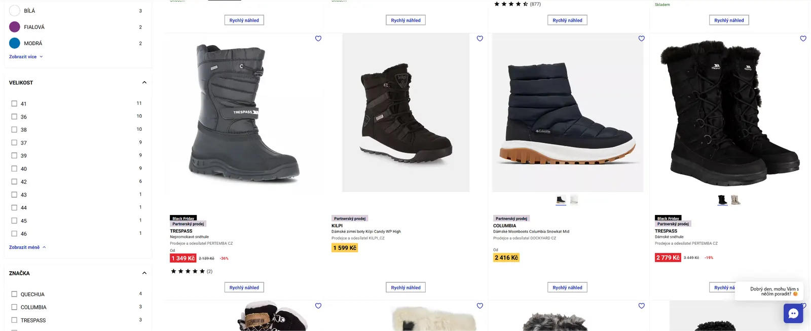</figure>
Screenshot of an online shoe shop

:::

::: cs

<figure class="dk-pic" style="left:0%;top:13.72%;width:100%;height:72.57%"></figure>
Screenshot of an online shoe shop

:::

::: notes en
Artifact 5 of 10.
:::

::: notes cs
Artefakt 5 z 10.
:::

---

::: en

<figure class="dk-pic" style="left:12.86%;top:2.96%;width:74.28%;height:94.07%">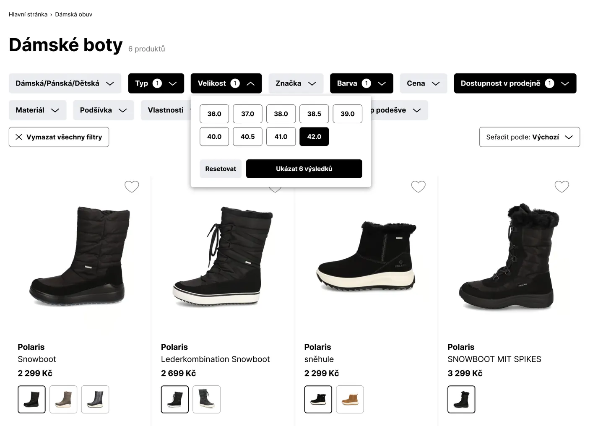</figure>
Screenshot of an online shoe shop

:::

::: cs

<figure class="dk-pic" style="left:12.86%;top:2.96%;width:74.28%;height:94.07%"></figure>
Screenshot of an online shoe shop

:::

::: notes en
Artifact 6 of 10.
:::

::: notes cs
Artefakt 6 z 10.
:::

---

::: en

<figure class="dk-pic" style="left:3.37%;top:17.45%;width:44.36%;height:65.09%">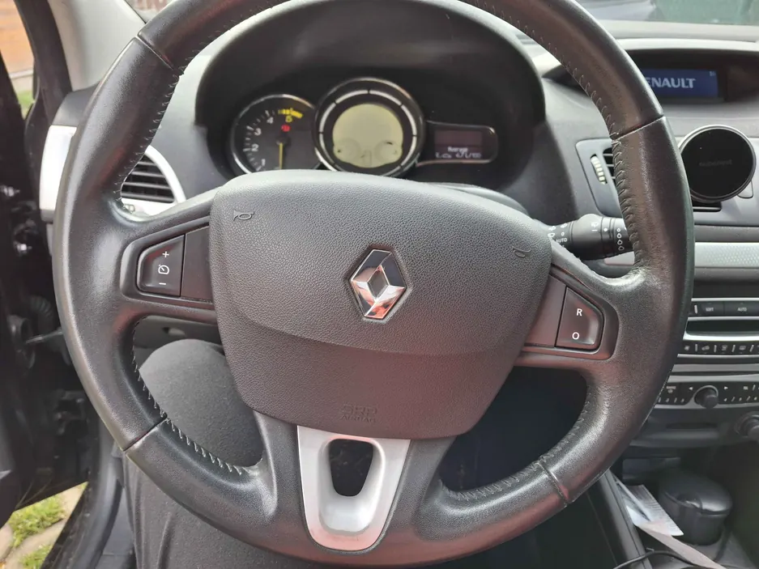</figure><figure class="dk-pic" style="left:50%;top:17.45%;width:46.55%;height:65.09%">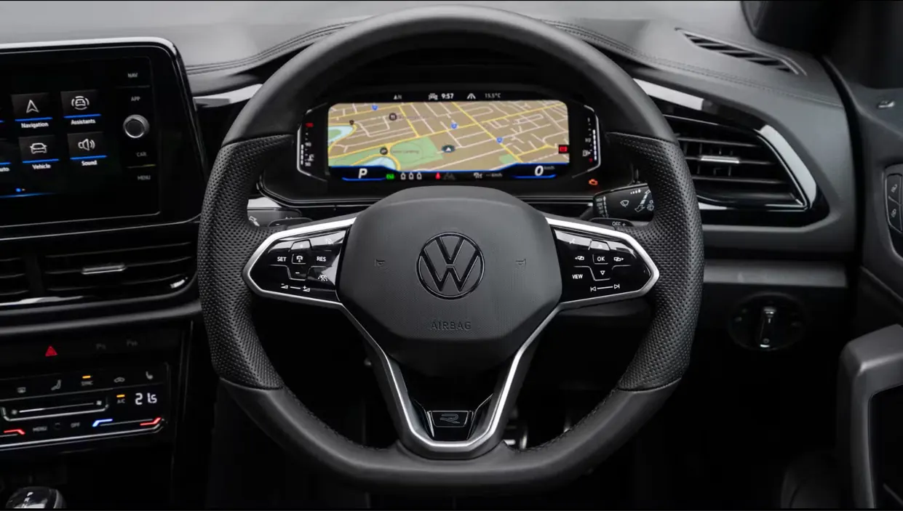</figure>

:::

::: cs

<figure class="dk-pic" style="left:3.37%;top:17.45%;width:44.36%;height:65.09%"></figure><figure class="dk-pic" style="left:50%;top:17.45%;width:46.55%;height:65.09%"></figure>

:::

::: notes en
Artifact 7 of 10.
:::

::: notes cs
Artefakt 7 z 10.
:::

---

::: en

<figure class="dk-pic" style="left:8.36%;top:15.7%;width:31.29%;height:68.6%">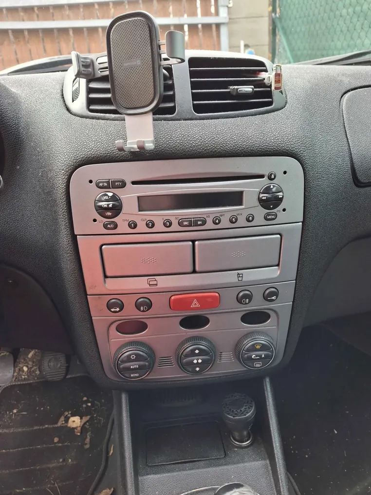</figure><figure class="dk-pic" style="left:45.78%;top:54.64%;width:39.78%;height:42.83%">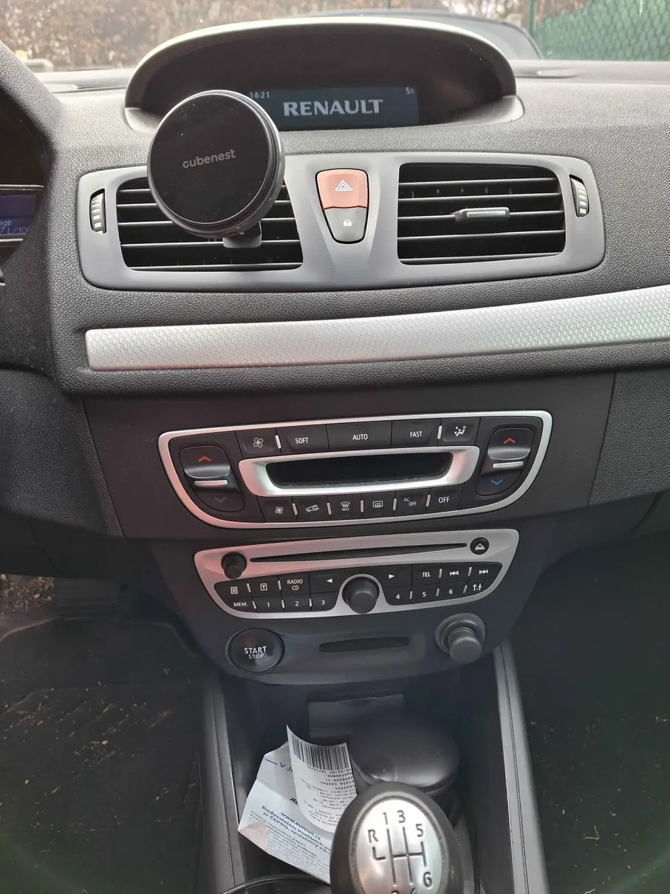</figure><figure class="dk-pic" style="left:44.78%;top:5.29%;width:41.77%;height:45.73%">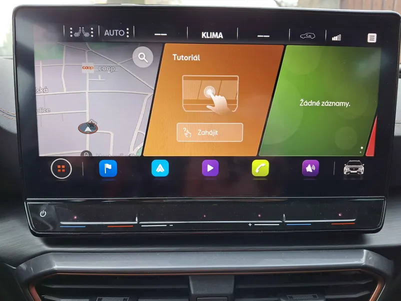</figure>

:::

::: cs

<figure class="dk-pic" style="left:8.36%;top:15.7%;width:31.29%;height:68.6%"></figure><figure class="dk-pic" style="left:45.78%;top:54.64%;width:39.78%;height:42.83%"></figure><figure class="dk-pic" style="left:44.78%;top:5.29%;width:41.77%;height:45.73%"></figure>

:::

::: notes en
Artifact 8 of 10.
:::

::: notes cs
Artefakt 8 z 10.
:::

---

::: en

<figure class="dk-pic" style="left:1.67%;top:2.96%;width:68.91%;height:94.07%">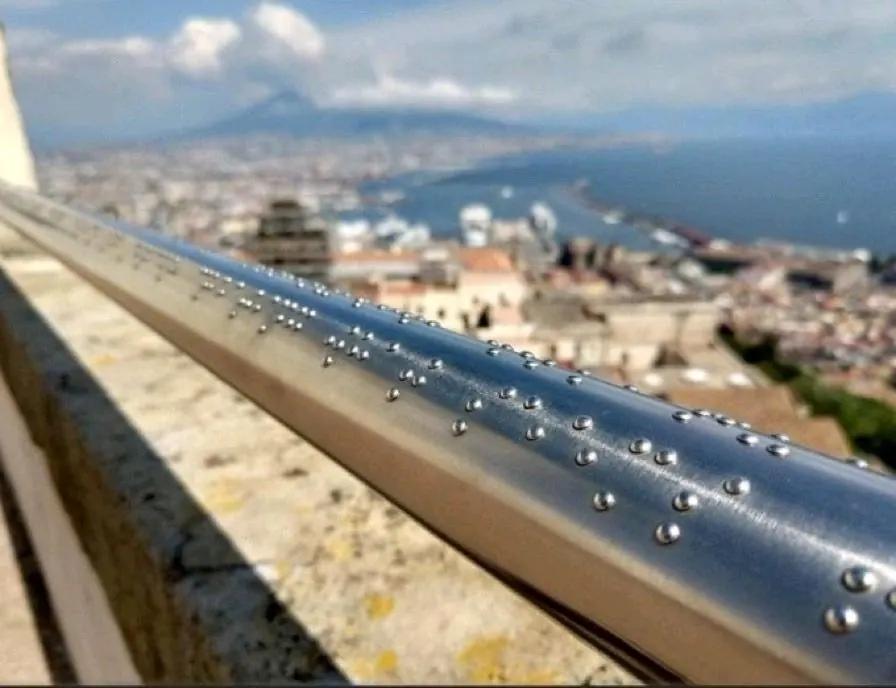</figure>
Photo from a LinkedIn post by Stuart Bernstein

:::

::: cs

<figure class="dk-pic" style="left:1.67%;top:2.96%;width:68.91%;height:94.07%"></figure>
Photo from a LinkedIn post by Stuart Bernstein

:::

::: notes en
Artifact 9 of 10.
:::

::: notes cs
Artefakt 9 z 10.
:::

---

::: en

<figure class="dk-pic" style="left:1.67%;top:9.81%;width:96.67%;height:80.39%">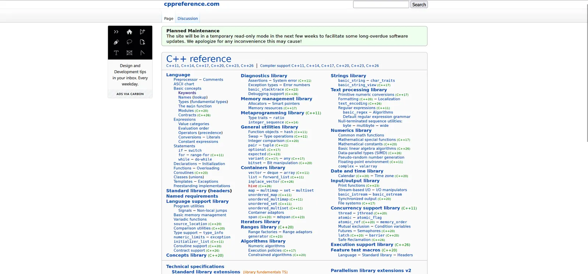</figure>
Screenshot: cppreference.com

:::

::: cs

<figure class="dk-pic" style="left:1.67%;top:9.81%;width:96.67%;height:80.39%"></figure>
Screenshot: cppreference.com

:::

::: notes en
Artifact 10 of 10.
:::

::: notes cs
Artefakt 10 z 10.
:::

---

::: en
# What do you see?

Think about the chosen artifact and describe, in your own words, what an interaction with it would look like.

**Pairs, 5 minutes**

- What would you do as a user?
- How would that make you feel?
:::
::: cs
# Co vidíte?

Zamyslete se nad vybraným artefaktem a popište svými slovy, jak by vypadala interakce s ním.

**Dvojice, 5 minut**

- Co byste jako uživatel dělali?
- Jak byste se při tom cítili?
:::

---

::: en
# What did you notice?

Share "your" experiences.

- What would you do as a user?
- How would that make you feel, and why?
- What might the authors have intended?
:::
::: cs
# Čeho jste si všímali?

Podělte se o "své" zážitky.

- Co byste jako uživatel dělali?
- Jak byste se při tom cítili? A proč?
- Jaký mohl být záměr autorů?
:::

---

::: en
# The user's view of an artifact
:::
::: cs
# Pohled uživatele na artefakt
:::

::: en
- What interaction can be expected?
- What does the user most likely feel, and why?
- What was the author's goal? What should the artifact achieve?
- How do you rate the artifact?
:::
::: cs
- Jakou interakci lze očekávat?
- Jaké pocity má nejspíše uživatel? A proč?
- Jaký byl cíl autora? Čeho mělo být tímto artefaktem dosaženo?
- Jak artefakt hodnotíte?
:::

::: notes en
The English deck has this slide only in Czech; this is a translation. Use it as the guide for the debrief.
:::
::: notes cs
Anglická verze měla tento slide jen česky; je to překlad do angličtiny. Slouží jako vodítko k závěrečné diskusi.
:::

---

::: en
# What is UX?
:::
::: cs
# Co je to UX?
:::

---

::: en
# What is UX?

In your own words, describe what you think UX is.
:::
::: cs
# Co je UX?

Vlastními slovy popište, co je podle vás UX.
:::

---

::: en
# How experts define UX

**Don Norman:** user experience covers every aspect of how an end user deals with a company, its services and its products.
:::
::: cs
# Jak UX definují odborníci

**Don Norman:** user experience zahrnuje všechny aspekty toho, jak koncový uživatel jedná se společností, jejími službami a produkty.
:::

::: notes en
Paraphrase, not a verbatim quote. Check the exact wording against the source before quoting it on a slide.
:::
::: notes cs
Parafráze, ne doslovná citace. Před citací na slidu ověřit přesné znění ve zdroji.
:::

---

::: en
# How experts define UX

**ISO 9241-210:** what a person perceives and how they respond when they use, or expect to use, a product, system or service.
:::
::: cs
# Jak UX definují odborníci

**ISO 9241-210:** to, co člověk vnímá, a jak reaguje, když produkt, systém nebo službu používá, nebo očekává, že je bude používat.
:::

---

::: en
# How experts define UX

**Peter Morville:** a good experience is useful, usable, desirable, accessible, credible and valuable.
:::
::: cs
# Jak UX definují odborníci

**Peter Morville:** dobré UX je užitečné, použitelné, žádoucí, přístupné, důvěryhodné a hodnotné.
:::

---

::: en
# What does good UX look like?
:::
::: cs
# Jak vypadá dobré UX?
:::

---

::: en
# What does good UX look like?

- How do you recognise it?
- How do you create it?
:::
::: cs
# Jak vypadá dobré UX?

- Jak ho poznáte?
- Jak ho vytvoříte?
:::

---

::: en
# Design process
:::
::: cs
# Designový proces
:::

---

::: en

<figure class="dk-pic" style="left:0%;top:8.01%;width:100%;height:83.99%">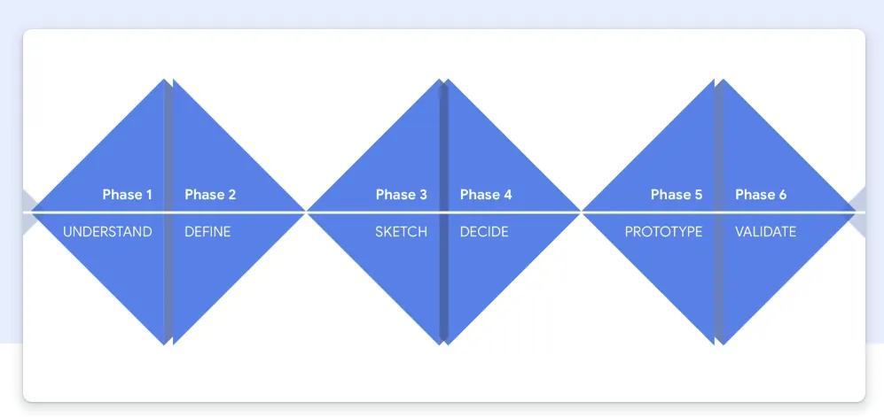</figure>

:::

::: cs

<figure class="dk-pic" style="left:0%;top:8.01%;width:100%;height:83.99%"></figure>

:::

::: notes en
The six phases: Understand, Define, Sketch, Decide, Prototype, Validate. The next six slides take them one by one; the small diagram in the corner shows where you are.
:::

::: notes cs
Šest fází: Pochopit, Definovat, Skicovat, Rozhodnout, Prototypovat, Ověřit. Dalších šest slidů je probere jednu po druhé; malý diagram v rohu ukazuje, kde jste.
:::

---

::: en
# UNDERSTAND

- **Goal:** get to know users and their needs
- **Method:** user interview. Ask users about their experiences, pains and needs.
- **When it fits:** at the start of a project, when you do not know what users really need
:::
::: cs
# UNDERSTAND: Pochopit

- **Cíl:** poznat uživatele a jejich potřeby
- **Metoda:** uživatelský rozhovor. Zeptejte se uživatelů na jejich zkušenosti, bolesti a potřeby.
- **Kdy se hodí:** na začátku projektu, když nevíte, co uživatelé opravdu potřebují
:::

::: en

<figure class="dk-pic" style="left:68.38%;top:80.58%;width:29.27%;height:17.18%">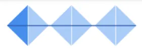</figure>

:::

::: cs

<figure class="dk-pic" style="left:68.38%;top:80.58%;width:29.27%;height:17.18%"></figure>

:::

---

::: en
# DEFINE

- **Goal:** state the problem clearly
- **Method:** personas. Create a fictional character who stands for a typical user and their challenge, need or problem.
- **When it fits:** when you have research data and want to turn it into a concrete "person", or when you need to share the results with someone else
:::
::: cs
# DEFINE: Definovat

- **Cíl:** jasně formulovat problém
- **Metoda:** persony. Vytvořte fiktivní postavu, která představuje typického uživatele a jeho výzvu, potřebu nebo problém.
- **Kdy se hodí:** když máte data z výzkumu a chcete je zhmotnit do konkrétního "člověka", nebo když výsledky potřebujete předat dál
:::

::: en

<figure class="dk-pic" style="left:68.09%;top:81.09%;width:30.52%;height:16.23%">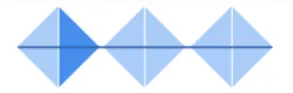</figure>

:::

::: cs

<figure class="dk-pic" style="left:68.09%;top:81.09%;width:30.52%;height:16.23%"></figure>

:::

---

::: en
# SKETCH

- **Goal:** generate as many ideas as possible
- **Method:** Crazy 8s. Draw 8 different solutions in 8 minutes.
- **When it fits:** when you want to explore different approaches quickly, without investing much time
:::
::: cs
# SKETCH: Skicovat

- **Cíl:** vygenerovat co nejvíc nápadů
- **Metoda:** Crazy 8s. Za 8 minut nakreslit 8 různých řešení.
- **Kdy se hodí:** když chcete rychle prozkoumat různé přístupy bez velké investice času
:::

::: en

<figure class="dk-pic" style="left:68.19%;top:80.61%;width:29.27%;height:17.22%">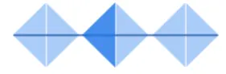</figure>

:::

::: cs

<figure class="dk-pic" style="left:68.19%;top:80.61%;width:29.27%;height:17.22%"></figure>

:::

---

::: en
# DECIDE

- **Goal:** choose the best idea to develop
- **Method:** dot voting. Everyone gets 3 dots and votes for the best ideas.
- **When it fits:** when you have several proposals and need to pick a direction democratically
:::
::: cs
# DECIDE: Rozhodnout

- **Cíl:** vybrat nejlepší nápad k rozpracování
- **Metoda:** dot voting. Každý dostane 3 tečky a hlasuje pro nejlepší nápady.
- **Kdy se hodí:** když máte více návrhů a potřebujete demokraticky vybrat směr
:::

::: en

<figure class="dk-pic" style="left:69.24%;top:80.92%;width:28.54%;height:17.88%">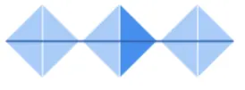</figure>

:::

::: cs

<figure class="dk-pic" style="left:69.24%;top:80.92%;width:28.54%;height:17.88%"></figure>

:::

---

::: en
# PROTOTYPE

- **Goal:** make a testable version of the idea
- **Method:** paper prototype. Draw the screens on paper and "click" through them by hand.
- **When it fits:** quick testing without programming
:::
::: cs
# PROTOTYPE: Prototypovat

- **Cíl:** vytvořit testovatelnou verzi nápadu
- **Metoda:** papírový prototyp. Nakreslete obrazovky na papír a "proklikávejte" je ručně.
- **Kdy se hodí:** rychlé testování bez nutnosti programovat
:::

::: en

<figure class="dk-pic" style="left:69.24%;top:81.26%;width:28.33%;height:17.51%">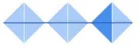</figure>

:::

::: cs

<figure class="dk-pic" style="left:69.24%;top:81.26%;width:28.33%;height:17.51%"></figure>

:::

---

::: en
# VALIDATE

- **Goal:** find out whether the solution works for the user
- **Method:** usability test. Watch real users use your prototype.
- **When it fits:** before the final launch. It saves time and money.
:::
::: cs
# VALIDATE: Ověřit

- **Cíl:** zjistit, jestli řešení funguje pro uživatele
- **Metoda:** usability test. Pozorujte reálné uživatele, jak používají váš prototyp.
- **Kdy se hodí:** před finálním vypuštěním produktu. Ušetříte čas i peníze.
:::

::: en

<figure class="dk-pic" style="left:69.15%;top:80.78%;width:28.23%;height:17.78%">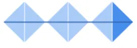</figure>

:::

::: cs

<figure class="dk-pic" style="left:69.15%;top:80.78%;width:28.23%;height:17.78%"></figure>

:::

---

::: en

Design is iterative!

:::
::: cs

Design je iterativní!

:::

::: en

<figure class="dk-pic" style="left:0%;top:0%;width:100%;height:83.99%"></figure>

:::

::: cs

<figure class="dk-pic" style="left:0%;top:0%;width:100%;height:83.99%"></figure>

:::

---

::: en
# Good UX/UI principles
:::
::: cs
# Dobré principy UX/UI
:::

---

::: en
# Heuristics...

...a fairly simple way to check the quality of your UX.
:::
::: cs
# Heuristiky...

...aneb jednoduchý způsob, jak ověřit splnění základních principů UX.
:::

::: en

<figure class="dk-pic" style="left:59.09%;top:0%;width:40.91%;height:100%">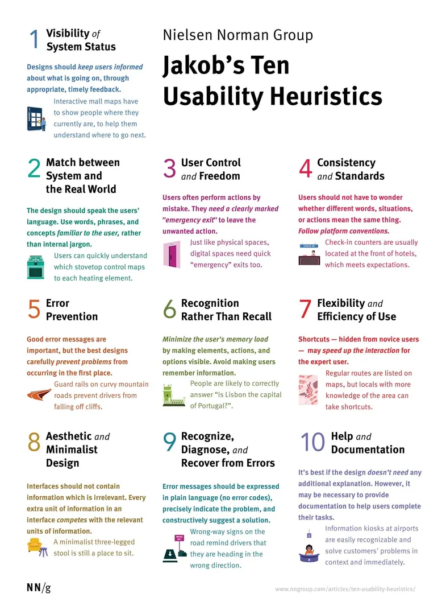</figure>
Poster: Nielsen Norman Group

:::

::: cs

<figure class="dk-pic" style="left:59.09%;top:0%;width:40.91%;height:100%"></figure>
Poster: Nielsen Norman Group

:::

::: notes en
The poster is the set of ten usability heuristics by Nielsen Norman Group (credited on the slide). Pick two or three and show an example of each from the artifacts above. The older 2024 deck went through all ten; see versions/2024-mvt-ui-ux.md.
:::

::: notes cs
Plakát je desítka heuristik použitelnosti od Nielsen Norman Group (zdroj je na slidu). Vyberte dvě tři a ke každé ukažte příklad z artefaktů výše. Starší deck z roku 2024 procházel všech deset; viz versions/2024-mvt-ui-ux.md.
:::

---

# UI fun

---

::: en
# Worst UI Challenge

Three well-known examples of deliberately terrible controls: a date picker, a volume control and a phone number entry.
:::
::: cs
# Worst UI Challenge

Tři známé příklady záměrně příšerných ovládacích prvků: výběr data, ovládání hlasitosti a zadání telefonního čísla.
:::

::: notes en
The original slide links to three third-party articles and a challenge page. Links are not copied here; pick current examples yourself.
:::
::: notes cs
Původní slide odkazuje na tři cizí články a stránku výzvy. Odkazy se sem nekopírují; aktuální příklady vyberte sami.
:::

---

::: en
# Your turn!

Suggest the worst possible control for setting the air-conditioning temperature.

**10 minutes**

Draw it, prompt it, do it any way you want, but we want to see it.
:::
::: cs
# Vaše výzva!

Navrhněte nejhorší možný ovladač pro nastavení teploty klimatizace.

**10 minut**

Kreslete, promptujte, udělejte to, jak chcete, ale budeme to chtít vidět.
:::

---

::: en
# The best worst UI...
:::
::: cs
# Nejlepší nejhorší UI...
:::

::: notes en
Show and vote on the students' designs. Their work is not stored in this repo.
:::
::: notes cs
Ukázat a odhlasovat návrhy studentů. Jejich práce se do tohoto repozitáře neukládají.
:::

---

::: en
# Bonus
:::
::: cs
# Bonus
:::

---

::: en
# Cost vs. benefit

When to do what, and how much of it?

- big vs. small projects
- motivation and goal
- budget and time
:::
::: cs
# Cena vs. benefit

Kdy co dělat v jakém rozsahu?

- velké vs. malé projekty
- motivace a cíl
- rozpočet a čas
:::

::: notes en
In the source decks this slide and the next two were in Czech only; English is a translation.
:::
::: notes cs
Ve zdrojových prezentacích byl tento slide a další dva jen česky; angličtina je překlad.
:::

::: en

<figure class="dk-pic" style="left:64.51%;top:36.92%;width:35.49%;height:63.08%">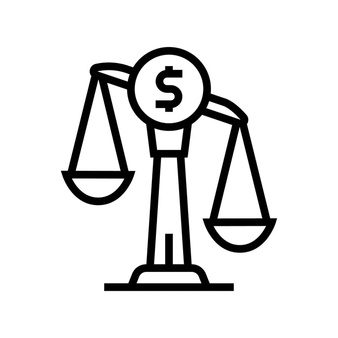</figure>
Icon: Getty Images

:::

::: cs

<figure class="dk-pic" style="left:64.51%;top:36.92%;width:35.49%;height:63.08%"></figure>
Icon: Getty Images

:::

---

::: en
# Dark patterns

- **Roach motel:** easy to get in, impossible to get out (for example cancelling a subscription)
- **Sneak into basket:** items added to the cart without consent
- **Misdirection:** highlighting the unimportant, hiding the important
- **Fake urgency:** "Only 2 rooms left!" (when it is not true)
:::
::: cs
# Dark patterns

- **Roach motel:** snadný vstup, nemožný výstup (např. zrušení předplatného)
- **Sneak into basket:** přidání položek do košíku bez souhlasu
- **Misdirection:** zvýraznění nepodstatného, skrytí důležitého
- **Fake urgency:** "Zbývají jen 2 pokoje!" (ale není to pravda)
:::

---

::: en
# Where to next?

- Design Sprint Kit
- 100 metod (MUNI)
- Asociace UX meetups
- Nielsen Norman Group
- UX Collective
- Interaction Design Foundation
:::
::: cs
# Kam dál?

- Design Sprint Kit
- 100 metod (MUNI)
- Meetupy Asociace UX
- Nielsen Norman Group
- UX Collective
- Interaction Design Foundation
:::

::: notes en
Names only, no links: the original links were not copied. Add checked links if wanted.
:::
::: notes cs
Jen názvy, bez odkazů: původní odkazy se nekopírovaly. Ověřené odkazy lze doplnit.
:::

---

::: en
# Exercise brief
:::
::: cs
# Zadání na cvičení
:::

---

::: en
# Air-conditioning control

Build a UI prototype for controlling an air conditioner (60 min).

- set temperature, current temperature, ventilation, planning a week ahead, several rooms

**Target devices**

- phone, computer, watch, conversational interface, embedded device, ...
- prototypes for at least 3 different devices
- made with anything, but it must be testable (Figma, code, a wireframe sketching tool, an AI app builder, ...)
- show the prototypes at the end of the exercise
:::
::: cs
# Ovládání klimatizace

Vytvořte prototyp UI pro ovládání klimatizace (60 min).

- nastavená teplota, aktuální teplota, větrání, plánování na týden dopředu, různé místnosti

**Cílová zařízení**

- telefon, počítač, hodinky, konverzační rozhraní, embedded zařízení, ...
- prototyp pro alespoň 3 různá zařízení
- prototyp může být udělaný čímkoli, ale musí být testovatelný (Figma, kód, nástroj na skici drátěných modelů, AI nástroj na tvorbu aplikací, ...)
- na konci cvičení ukázka prototypů
:::
