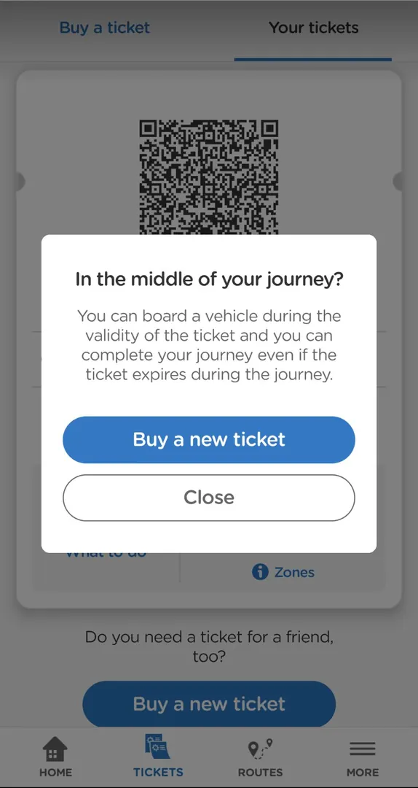
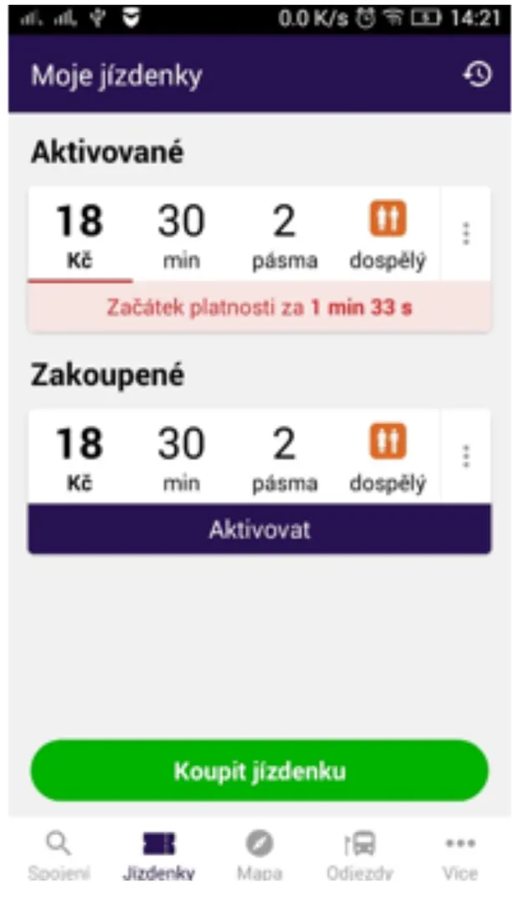
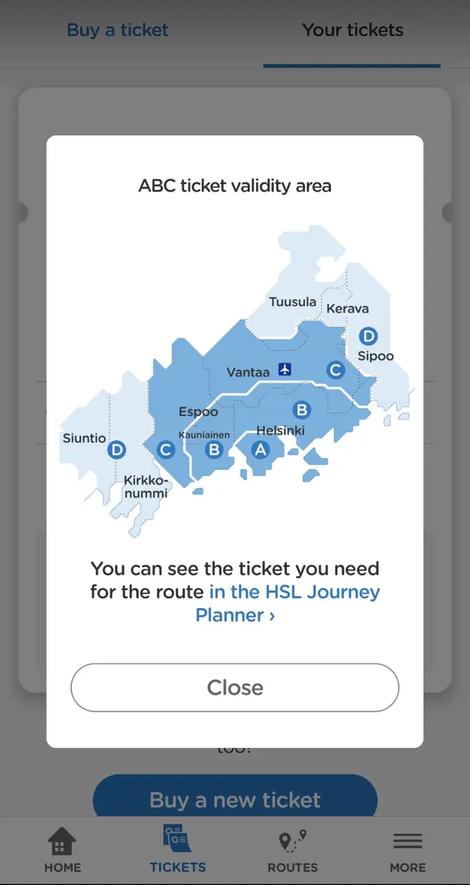
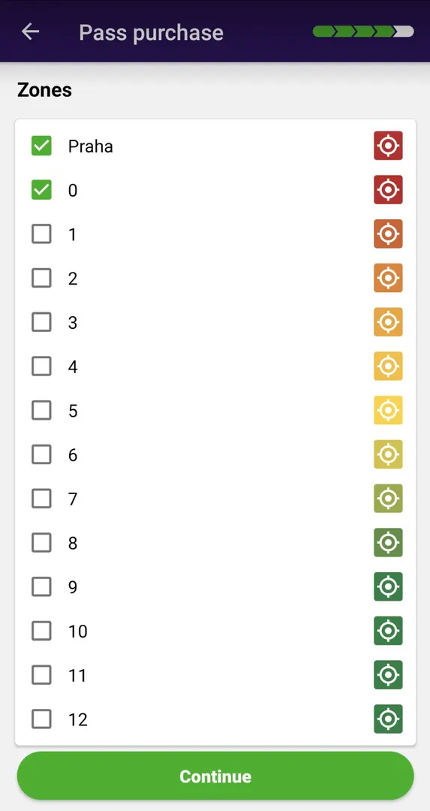
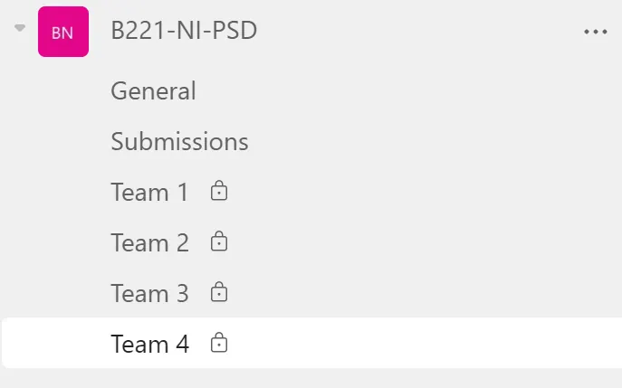
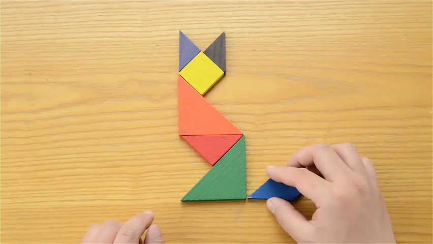
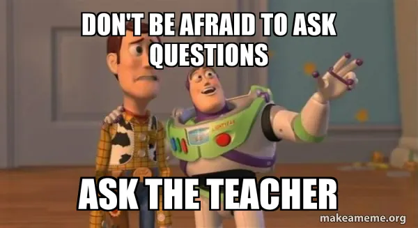

# NI-PSD
## Public service design

::: notes
Course opening. Title slide of the first lecture of NI-PSD.
:::

---

# Who are we?

<figure class="dk-pic" style="left:29.97%;top:22.38%;width:31.07%;height:55.24%"></figure><figure class="dk-pic" style="left:66.09%;top:22.38%;width:31.07%;height:55.24%"></figure>

::: notes
The two teachers of the course introduce themselves.
:::

---

# Who are you?

::: notes
Short round: each student says their name, programme and background.
:::

---

# Your motivation?
## [5 min]

::: notes
Short round of answers, about 5 minutes. The original shows this slide twice (a second step of the same slide).
:::

---

# Your motivation?
## [5 min]

::: notes
In the original this step shows a photo of the students' answers from an earlier run. The photo is not published here because it shows student work.
:::

---

# Your expectations?
## [5 min]

::: notes
Short round of answers, about 5 minutes. The original shows this slide twice.
:::

---

# Your expectations?
## [5 min]

::: notes
In the original this step shows a photo of the students' answers from an earlier run. The photo is not published here because it shows student work.
:::

---

# Team exercise
## [20 min]

- Discuss topic in team
- Make notes
- Present results

::: notes
The topic of the exercise was shown as an image or was said aloud; it is not in the text of the original.
:::

---

# Team exercise
## [20 min]

::: notes
In the original this step shows four photos of the teams' whiteboards from an earlier run (why public service, nice public service, design, public service). They are not published here because they show student work.
:::

---

# WHY?

::: notes
Opens a short sequence of image slides on why public services should be designed.
:::

---

<figure class="dk-pic" style="left:12.46%;top:0%;width:29.89%;height:100%"></figure><figure class="dk-pic" style="left:55.91%;top:0%;width:31.96%;height:100%"></figure>
Screenshots: HSL app (left), PID Lítačka (right)

::: notes
Two ticket apps side by side. What does each ask of the traveller, and when?
:::

---

<figure class="dk-pic" style="left:13.34%;top:0%;width:29.93%;height:100%"></figure><figure class="dk-pic" style="left:55.24%;top:0%;width:29.86%;height:100%"></figure>
Screenshots: HSL app (left), PID app (right)

::: notes
Buying a ticket by zones in two apps: a map with an explanation, or a long list to tick.
:::

---

<figure class="dk-pic" style="left:0%;top:-10.73%;width:100%;height:118.49%"></figure>

---

# Organizational stuff

Grading, schedule, projects, teams, ...

---

# Time

- Time requirements and expectations
- 4 ECTS = 112 h of study work
- Classes = 36 h
- Your project work = 72 h

---

# Expected outcomes

- Problem statement - project brief
- Research report
- Concept sketches
- Prototype
- Validation
- Presentation

---

# Evaluation

- Team project - team work (80 %)
- Self assessment and individual work (20 %)
  - What did I learn in respect to my learning goal?
  - What did I bring to the team?

---

# Grading

| Grade | Points | Meaning |
| --- | --- | --- |
| A | 90+ | Extra effort or initiative with the project solution |
| B | 80-90 | Project was completed in full [baseline] |
| C | 70-80 | Project completed with minor issues |
| D | 60-70 | Project is missing an entire outcome |
| E | 50-60 | Multiple outcomes are missing |
| F | &lt;50 | You did not give a damn about the project |

---

# Schedule

::: notes
Image slide in the original: the semester schedule as a table or picture. Not available here; add it as text when the schedule of the next run is known.
:::

---

# MS Teams

- Private channel in the course team for each team
- Submissions to the submission channel
- Questions in General

<figure class="dk-pic" style="left:35.93%;top:34.98%;width:55.08%;height:61.14%"></figure>

---

# Courses

IN PROGRESS

---

# Tangram

<figure class="dk-pic" style="left:0%;top:0%;width:100%;height:100.16%"></figure>

---

<figure class="dk-pic" style="left:-1.61%;top:-0%;width:103.21%;height:100%"></figure>
Meme made with makeameme.org

---

# Project topics

---

# Teams

- 4-5 members
- Different backgrounds of members
- Establish a member responsible for team communication
- ... what else?

---

# Teams: role

Question of the team-forming survey (in Czech, as in the original):

**Jaká role je pro vás prioritní v rámci projektu?**

- UX Designer
- Projekťák
- Programátor
- Výzkumník
- Business developer
- Obchodník

---

# Teams: study programme

Question of the team-forming survey (in Czech, as in the original):

**Jaké zaměření máte za sebou/nebo ho studujete?**

- Informační bezpečnost
- Manažerská informatika
- Počítačová grafika
- Počítačové inženýrství
- Sítě a Internet

- Systémy a virtualizace
- SW inženýrství
- Teoretická informatika
- Umělá inteligence
- Webové inženýrství

