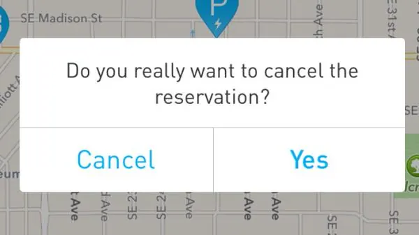
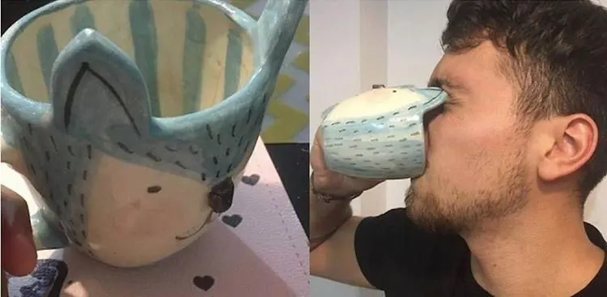
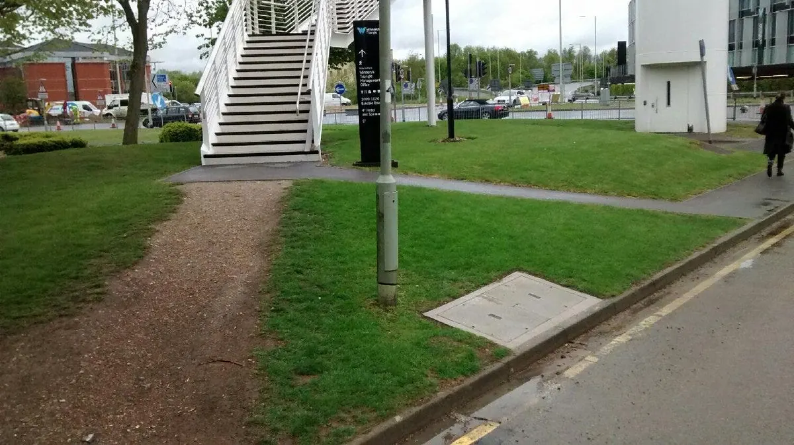
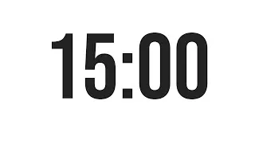

# Testing
## NI-PSD, Ondřej Brém

---

<figure class="dk-pic" style="left:0%;top:0%;width:100%;height:100%"></figure>
Video on YouTube (click to open)

::: notes
Opening video: click the picture to open it on YouTube.
:::

---

<figure class="dk-pic" style="left:1.67%;top:2.96%;width:62.5%;height:62.41%"></figure>

::: notes
A dialog to discuss: which button cancels the reservation?
:::

---

::: notes
In the original this slide is a screenshot of a social-media post by a private person (a street photo with a comment about where to walk). It is not published here.
:::

---

<figure class="dk-pic" style="left:1.67%;top:2.96%;width:62.5%;height:62.41%"></figure><figure class="dk-pic" style="left:7.98%;top:13.17%;width:39.77%;height:67.96%"></figure>

::: notes
Hidden in the original deck: the next step of the build.
:::

---

<figure class="dk-pic" style="left:1.67%;top:2.96%;width:62.5%;height:62.41%"></figure><figure class="dk-pic" style="left:7.98%;top:13.17%;width:39.77%;height:67.96%"></figure><figure class="dk-pic" style="left:7.98%;top:13.17%;width:78.13%;height:67.96%"></figure>

::: notes
Hidden in the original deck: the next step of the build.
:::

---

<figure class="dk-pic" style="left:1.67%;top:2.96%;width:62.5%;height:62.41%"></figure><figure class="dk-pic" style="left:7.98%;top:13.17%;width:39.77%;height:67.96%"></figure><figure class="dk-pic" style="left:7.98%;top:13.17%;width:78.13%;height:67.96%"></figure><figure class="dk-pic" style="left:5.51%;top:9.12%;width:88.97%;height:88.84%"></figure>

::: notes
Hidden in the original deck: the last step, a path worn beside the stairs.
:::

---

# Ways to test

- 5 second test
- UX test
- Fake door test
- Wizard of Oz test
- Beta release
- A/B test

- Screen recording
- Heat mapping
- Analytics
- Interviews with testers
- Surveys
- Performance evaluation

<figure class="dk-pic" style="left:0%;top:0%;width:32.33%;height:100%"></figure>
Photo by SpaceX

---

# Preparation

- Prototype
- Sprint questions or a test hypothesis
- 5 users (the usual rule of thumb: about 85 % of problems come from 5 people)
- A test story, to give testers context

---

# 15 mins
## Prepare your stories

::: notes
Short team work, 15 minutes: each team prepares the story that frames the test for its testers.
:::

---

<figure class="dk-pic" style="left:0%;top:0%;width:100%;height:100%"></figure>
Timer video on YouTube (click to open)

::: notes
A 15-minute timer video; the presenter clock does the same.
:::

---

# Dos and don'ts

**Do**

- Be neutral and encouraging
- Ask probing questions (why, what, how, ...)
- Answer questions with a question
- Ask for clarification if need be
- Ask follow-up questions

**Don't**

- Ask about the future
- Intimidate
- Ask leading questions
- Make them feel stupid

---

<figure class="dk-pic" style="left:0%;top:0%;width:100.52%;height:100.52%"></figure>
Video on YouTube (click to open)

::: notes
Video: click the picture to open it on YouTube.
:::

---

# The five-act interview

1. **Friendly welcome.** People open up when they feel comfortable. Greet them warmly, make small talk, explain how the session works and say that the product is being tested, not them.
2. **Context questions.** Start slowly with questions about the person's life, interests and activities. This builds rapport and helps you read their later reactions.
3. **Introduce the prototype.** Ask whether they would look at some prototypes. Warn them that parts may not work yet and that you will explain. Ask them to think aloud.
4. **Tasks and nudges.** Realistic tasks simulate real use best. Gently prompt people to keep thinking aloud, without pressure.
5. **Quick debrief.** Close with a few questions, for example how they would describe the product to a friend, or how it compares with what they use now.

---

# Watch together, learn together

Watch the interviews as a team. It is faster, because everyone absorbs the results at once, and the conclusions are better when all heads work together. At the end of the day the team can decide what to do next.

---

# Take notes as a group

1. **Draw a grid** on a large whiteboard before the first interview: one column per interviewed person, a few rows for each prototype part or sprint question.
2. **Agree on a notation**: coloured sticky notes or markers, or + / - / ~ for positive, negative and neutral. Everyone writes down quotes, observations or their interpretation of what happened.
3. **Be quiet** during the interviews. Take a break after each one.
4. **Put the notes in the grid** at the end of each interview, into the right row and column.

---

# Put notes on the board after each interview

A whiteboard grid: columns are the interviewed people, rows are the parts of the prototype (marketing page, sign up, first experience) and the sprint question (successfully set up a new account). Notes are marked as positive (+), neutral (~) or negative (-).

::: notes
In the original this board is drawn with shapes and sticky notes, with invented first names and sample quotes. It is not redrawn here; draw it on the whiteboard.
:::

---

# Whole day

## Interview customers, take notes

- Everyone writes down quotes, observations or their interpretation of what happened
- Be quiet during the interviews
- At the end of each interview, collect the notes and stick them to the whiteboard
- Mark notes as positive (+), neutral (~) or negative (-)

<figure class="dk-pic" style="left:10.94%;top:36.37%;width:2.45%;height:4.35%"></figure>

::: notes
Overview of the testing day, with the same example board as the previous slide.
:::

---

# One last thing...

1. **Look for patterns.** After all interviews, 5 to 10 minutes: the team gathers near the board, close enough to read the notes, and each person writes down the patterns they see on a notepad.
2. **Share the patterns.** Each person reads theirs aloud while the facilitator writes them down where all can see, marked as positive, negative or neutral.
3. **Review the sprint questions.** They help rank the patterns and point to next steps.
4. **Decide the next steps.** A short discussion, then the decider decides how to follow up.
